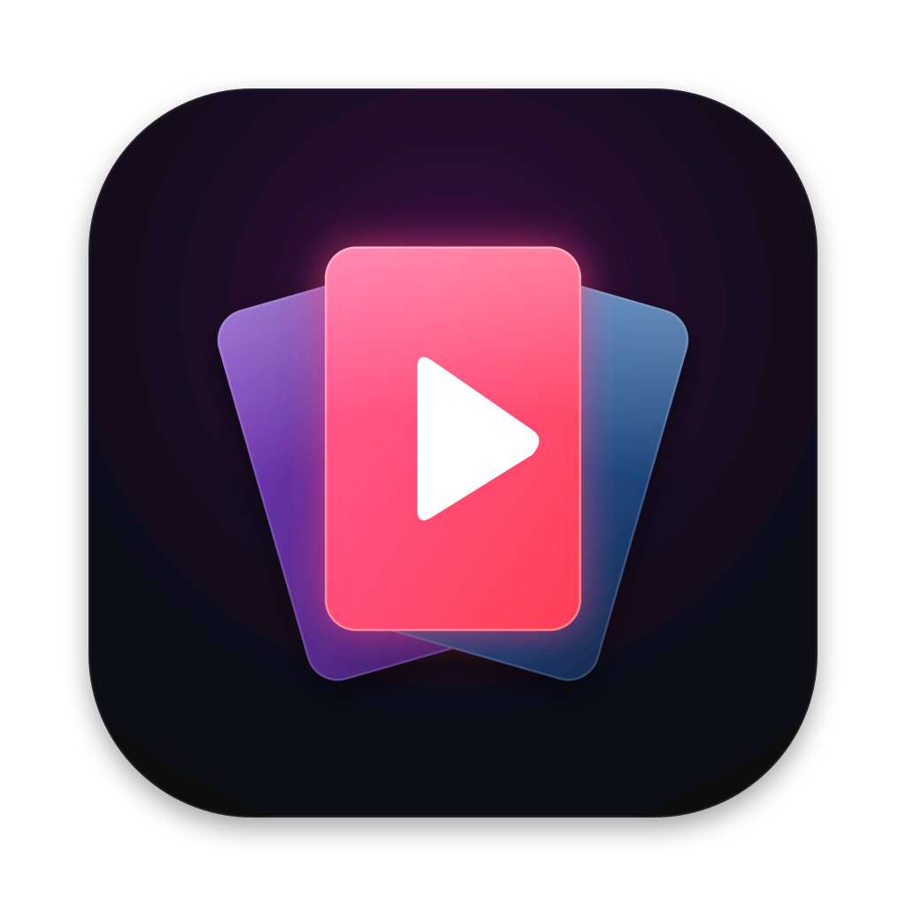

# VNDegen

VNDegen runs PC visual novels and RPG Maker games natively on Mac, iPhone, and iPad. Copy a game's folder into the library, and VNDegen detects its engine and lists it in a game hub modeled on Steam's Big Picture mode, with artwork from Steam and other sources. Play starts it.

The games run unmodified. VNDegen does not convert or repack them, and their saves stay compatible with the PC versions.

<p align="center">
  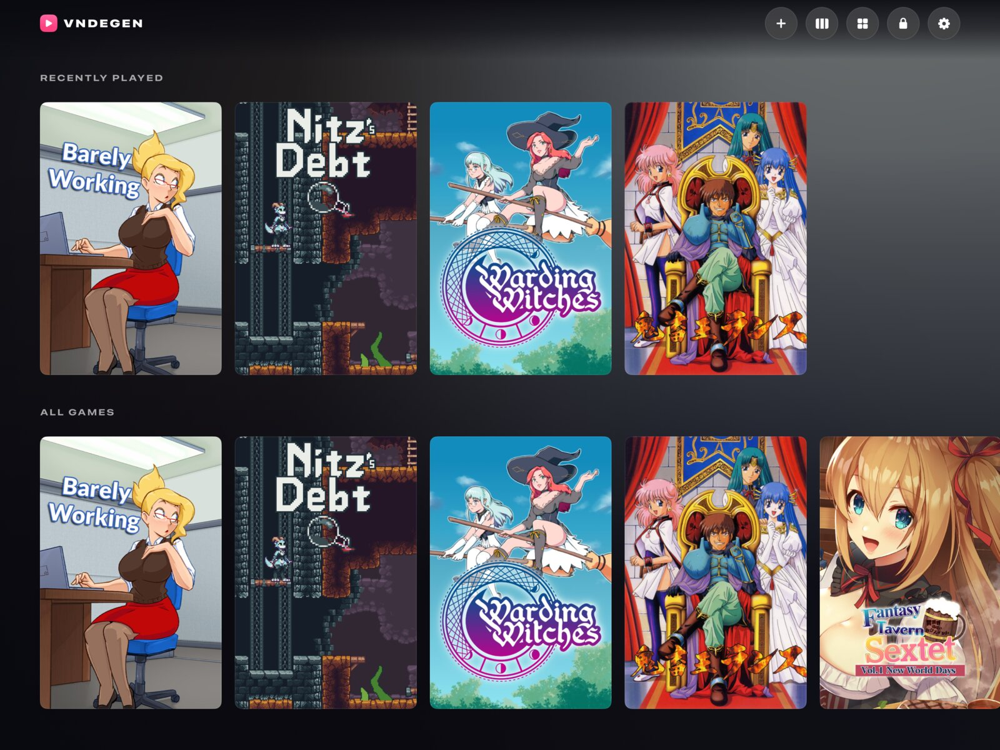
  <br><sub>iPad: Capsule rows</sub>
</p>

<p align="center">
  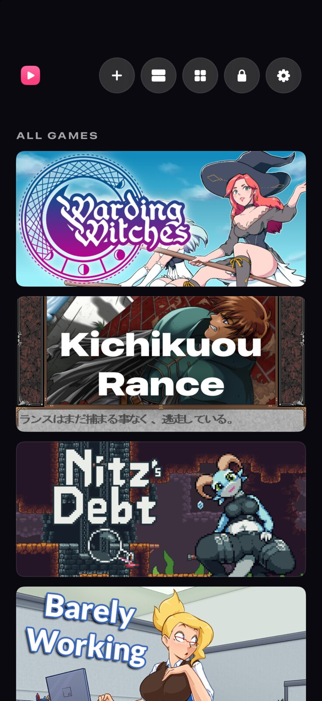
  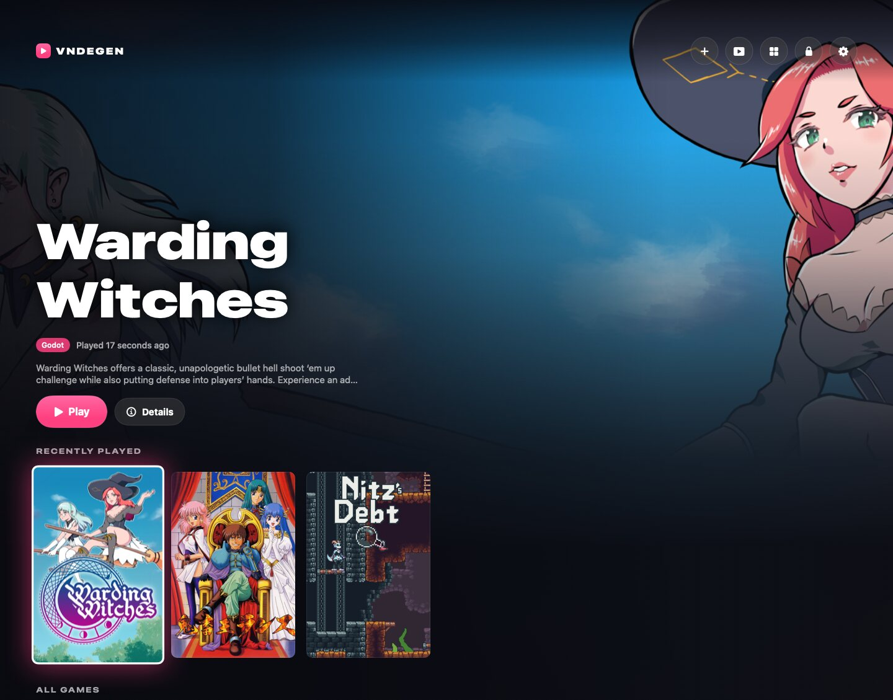
  <br><sub>iPhone in portrait: Header list &nbsp;·&nbsp; Mac: Featured</sub>
</p>

## Features

- **PC games on their own engines**, including RPG Maker, Ren'Py, KiriKiri, Godot, and Flash. See [Supported engines](#supported-engines).
- **Engine detection.** VNDegen recognizes each game by its files and shows which file identified it. You can assign an engine by hand. [Engines](docs/engines.md)
- **Artwork and metadata** from Steam, SteamGridDB, IGDB, and VNDB, and any art slot can be replaced. [Library](docs/library.md#artwork-and-metadata)
- **Four library layouts**, Header list, Capsule rows, Featured, and Grid, that fit iPhone portrait and landscape, iPhone Duo, iPad full screen or in a window, and Mac windows of any size. [Layouts](#layouts-on-each-device)
- **Touch, mouse and keyboard, and controllers** drive the hub and the games, with a library of controller layouts you can pick per game, edit, and add to, and a layout suggested from an RPG Maker MV, MZ, Godot, Artemis, or Wolf RPG Editor game's own files. [Controls](docs/controls.md)
- **More than one games folder**, such as an external drive or a server, and archives unpack straight into the library. [Library](docs/library.md#adding-games)
- **Game menu.** A long press, a right click, or X on a controller opens Play, Change artwork, Hide, Remove, and more. [Library](docs/library.md#the-game-menu)
- **Remove engine files.** RPG Maker MV and MZ, TyranoScript, Visual Novel Maker, and Ren'Py games can drop the PC engine files they don't need in VNDegen, about 88 to 295 MB a game on average. The game won't run on a PC from that folder afterwards. [Library](docs/library.md#removing-engine-files)
- **Game commands.** Menus a game keeps in its window's menu bar, such as KiriKiri's, appear in the VNDegen menu. [Controls](docs/controls.md#game-commands)
- **Cheats** for RPG Maker MV, MZ, XP, VX, and VX Ace, Wolf RPG Editor, and AliceSoft System 3 and 4: gold, items, encounters, game speed, variables with a find by value, and switches. Godot and Flash games get game speed. [Controls](docs/controls.md#cheats)
- **Hidden games** behind Face ID, Touch ID, or a passcode. [Library](docs/library.md#hidden-games)
- **Links ask first.** A web page or mail address a game opens, such as a title's Discord or Patreon button, asks before it opens your browser or mail app. Godot and web games can't open files or run other programs. [Engines](docs/engines.md#rpg-maker-mv-and-mz)
- **Ludusavi saves.** Back up and restore through the SMB share, FTP server or WebDAV server your Ludusavi uses, so saves move between VNDegen and your PCs. [Ludusavi](docs/ludusavi.md)
- **Windows fonts.** Games that ask for MS Gothic, Arial, and other Windows fonts get free fonts with the same metrics. [Fonts](docs/fonts.md)
- **Movies and see-through clips.** Native engines decode their own movies, and RPG Maker MV and MZ clips with transparency are converted the first time they play. [Video](docs/video.md)
- **Hardware rendering** through Metal, directly or through WebGL, OpenGL, or ANGLE. [Engines](docs/engines.md)

## Layouts on each device

The view button in the top bar switches between Header list, Capsule rows, Featured, and Grid, and each device keeps its own choice.

<p align="center">
  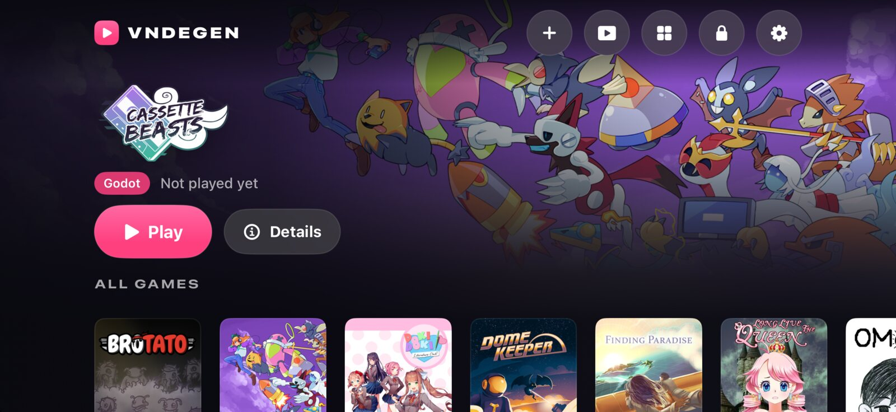
  <br><sub>iPhone in landscape: Featured</sub>
</p>

<p align="center">
  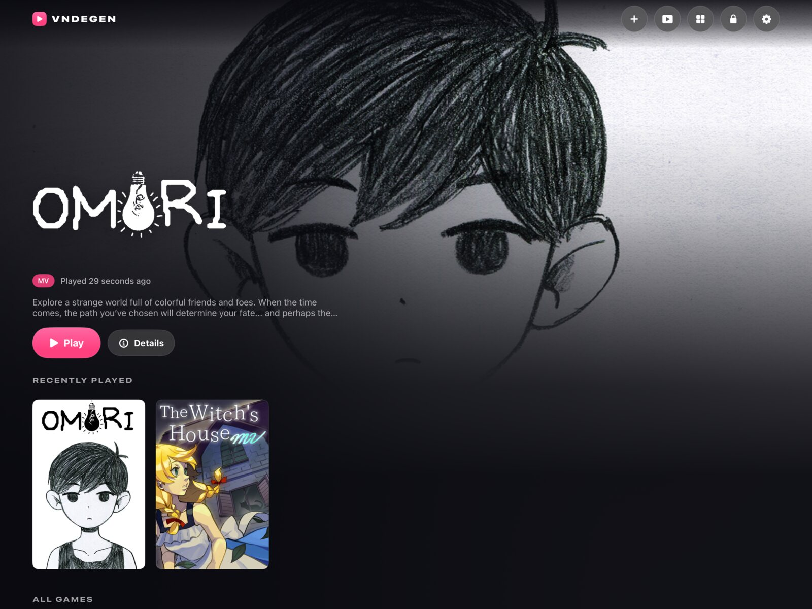
  <br><sub>iPad: Featured</sub>
</p>

<p align="center">
  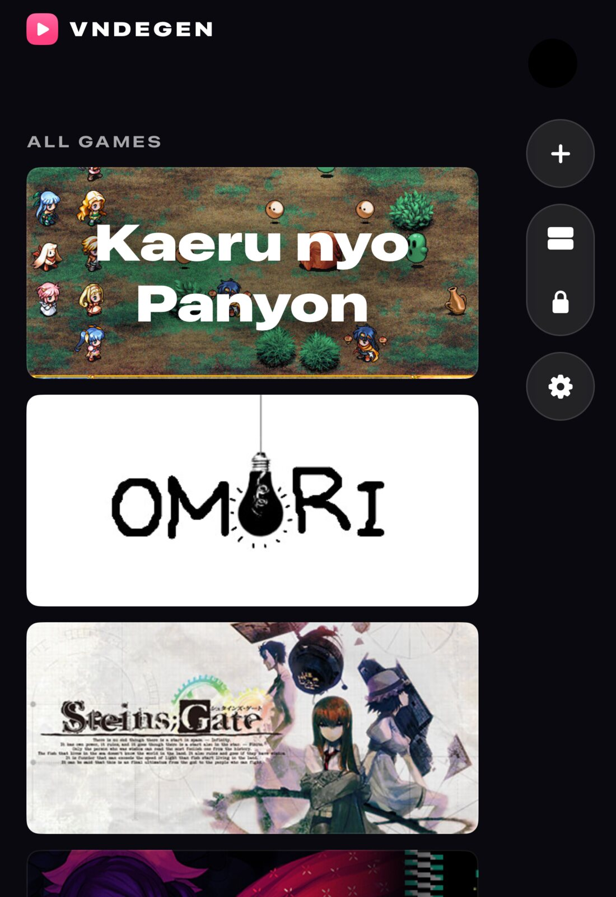
  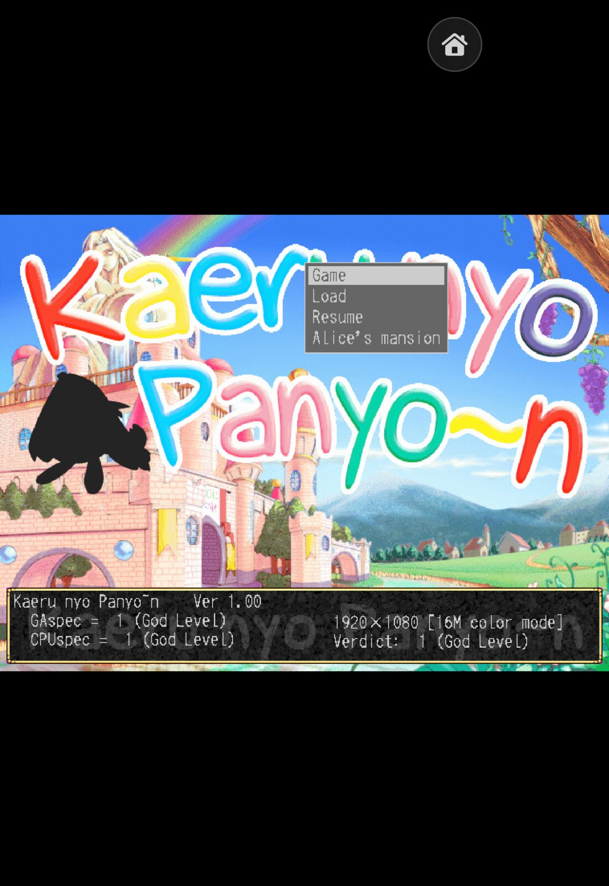
  <br><sub>iPhone Duo closed, front display upright: library &nbsp;·&nbsp; Kaeru nyo Panyon with in-game orientation set to Portrait</sub>
</p>

<p align="center">
  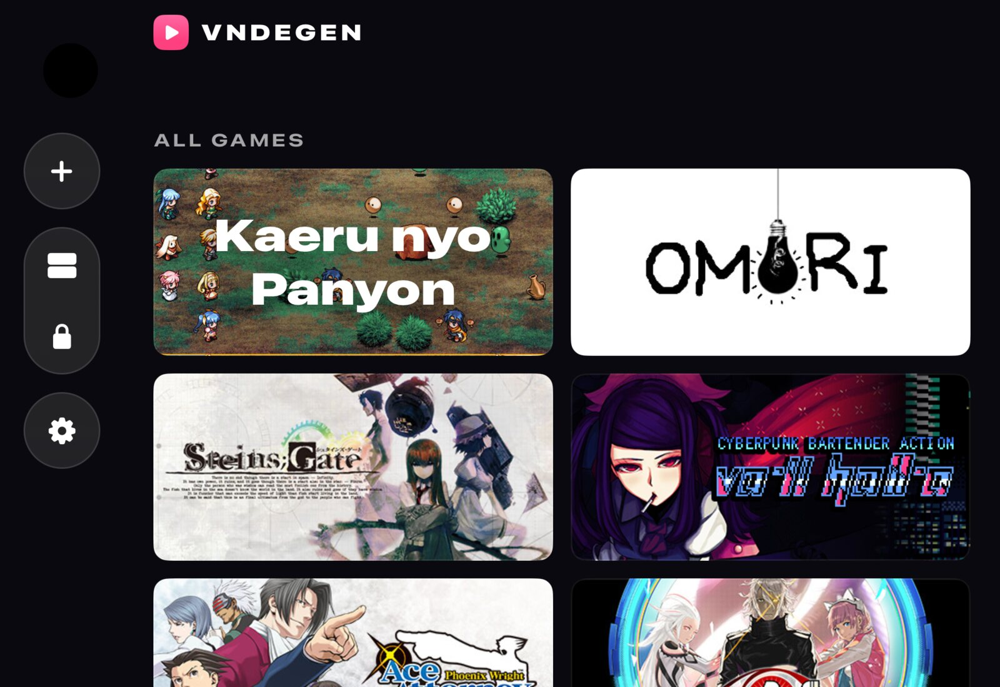
  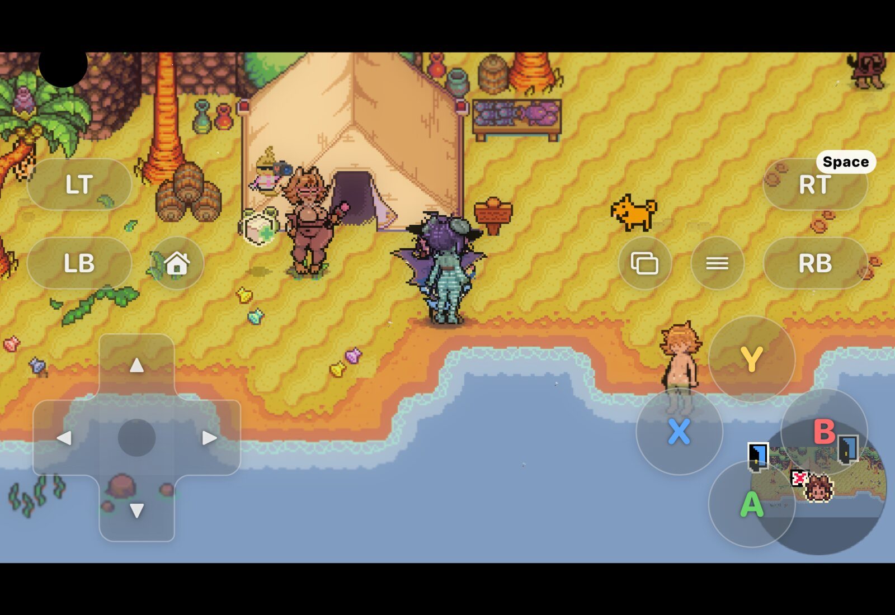
  <br><sub>iPhone Duo closed, front display on its side: library &nbsp;·&nbsp; No Socks RPG at Full width with the touch gamepad</sub>
</p>

<p align="center">
  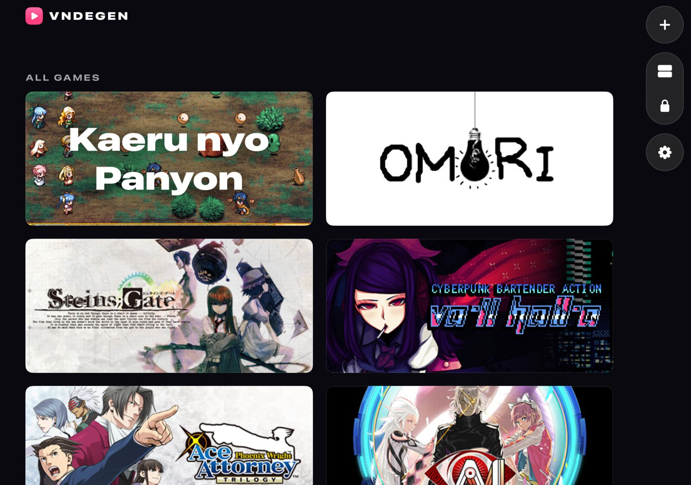
  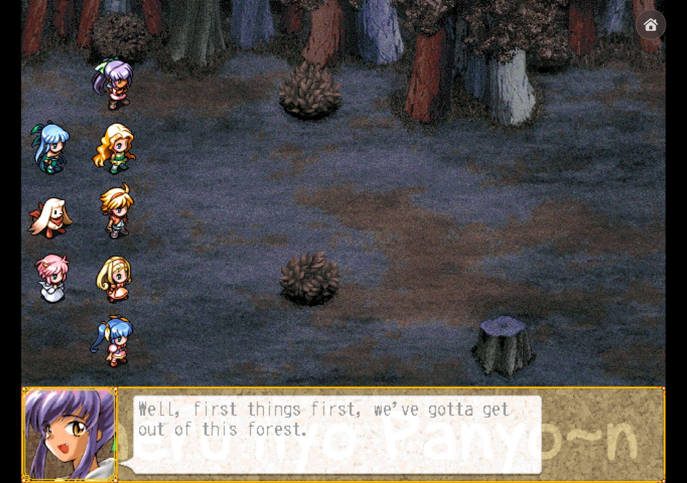
  <br><sub>iPhone Duo open, inner display held like a book: library &nbsp;·&nbsp; Kaeru nyo Panyon</sub>
</p>

<p align="center">
  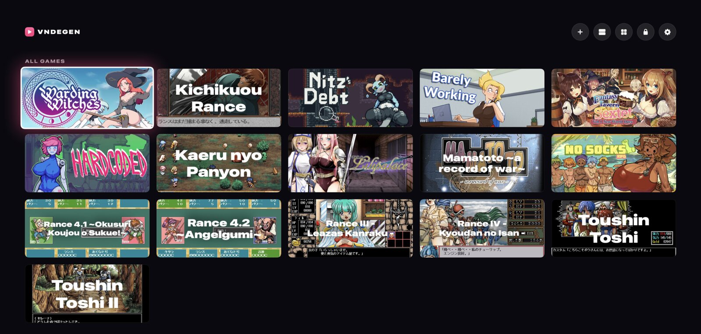
  <br><sub>Mac, wide window: Header list</sub>
</p>

## Supported engines

| Engine | VNDegen detects | Platforms | Details |
|---|---|---|---|
| RPG Maker MZ | `js/rmmz_core.js` | Mac, iPhone, iPad | [engines.md](docs/engines.md#rpg-maker-mv-and-mz) |
| RPG Maker MV | `js/rpg_core.js` or `www/js/rpg_core.js` | Mac, iPhone, iPad | [engines.md](docs/engines.md#rpg-maker-mv-and-mz) |
| TyranoScript and TyranoBuilder | `tyrano/plugins/kag/kag.js`, also in NW.js and Electron builds | Mac, iPhone, iPad | [engines.md](docs/engines.md#tyranoscript) |
| Ren'Py 6.99 to 8 | `renpy/` beside a `game/` folder of scripts | Mac, iPhone, iPad | [engines.md](docs/engines.md#renpy) |
| RPG Maker XP, VX, and VX Ace | `Game.ini` beside a `Game.rgss*` archive or `Data/Scripts.*` | Mac, iPhone, iPad | [rgss.md](docs/rgss.md) |
| KiriKiri 2 and KiriKiri Z | `data.xp3`, `data/startup.tjs`, or an archive in the `.exe` | Mac, iPhone, iPad | [engines.md](docs/engines.md#kirikiri) |
| Artemis | a `.pfs` archive or a `system.ini` | Mac, iPhone, iPad | [artemis.md](docs/artemis.md) |
| SiglusEngine | `Scene.pck` or `Gameexe.dat` | Mac, iPhone, iPad | [siglus.md](docs/siglus.md) |
| Godot 3 and Godot 4 | a `.pck` file, or a pack inside the game's `.exe` | Mac with Apple silicon, iPhone, iPad | [godot.md](docs/godot.md) |
| Flash (ActionScript 1, 2, and 3) | a projector `.exe`, a `.swf`, or an HTML page that launches movies | Mac, iPhone, iPad | [flash.md](docs/flash.md) |
| Visual Novel Maker | `index.html` with `data/ENGINE.js` and `data/SCRIPTS.js`, also in NW.js and Electron builds | Mac, iPhone, iPad | [htmlvn.md](docs/htmlvn.md) |
| Twine 1 and 2 | an HTML file holding the story, also in a Unity player's Embedded Browser pack | Mac, iPhone, iPad | [htmlvn.md](docs/htmlvn.md) |
| Construct 3 | `index.html`, `data.json` and `scripts/c3runtime.js`, also in Windows WebView2 builds | Mac, iPhone, iPad | [construct.md](docs/construct.md) |
| NScripter and Ponscripter | `nscript.dat`, or `0.txt`, `00.txt` or Ponscripter's `0.utf` beside NScripter archives | Mac, iPhone, iPad | [nscripter.md](docs/nscripter.md) |
| Wolf RPG Editor 2 and 3 | `Data.wolf`, `Data/BasicData`, or `Data/BasicData.wolf` | Mac, iPhone, iPad | [wolfrpg.md](docs/wolfrpg.md) |
| AliceSoft System 3.0 to 3.9 | `System39.ain` beside a scenario archive such as `RanceSA.ALD`, or `ADISK.DAT` | Mac, iPhone, iPad | [system3.md](docs/system3.md) |
| AliceSoft System 4 | an `.ain` code file beside `AliceStart.ini`, `System40.ini`, or `System40.exe` | Mac, iPhone, iPad | [system4.md](docs/system4.md) |
| NekoSDK (17 games) | `cfg.pak` beside `scr.pak` | Mac, iPhone, iPad | [engines.md](docs/engines.md#nekosdk) |
| YU-RIS | `yscfg.dat` or `ysbin.ypf` beside `.ypf` archives | Mac, iPhone, iPad | [yuris.md](docs/yuris.md) |
| Nitroplus N2System | `system.npa` beside `nss.npa` | Mac, iPhone, iPad | [n2system.md](docs/n2system.md) |
| Tmr-Hiro ADV System | `srp.pac` beside `Agrd.pac` | Mac, iPhone, iPad | [tmrhiro.md](docs/tmrhiro.md) |
| IPAC | `DATA/Scr.PAK` beside `DATA/Parts.PAK` | Mac, iPhone, iPad | [ipac.md](docs/ipac.md) |
| Ikura GDL | `SNR` beside `GRP` | Mac, iPhone, iPad | [ikura.md](docs/ikura.md) |
| EAGLS | `Script/SCPACK.idx` beside `CG/CGPACK.idx` | Mac, iPhone, iPad | [eagls.md](docs/eagls.md) |
| ExHibit | `ExHIBIT.ini` beside `resident.dll` and `rld/start.rld` | Mac, iPhone, iPad | [exhibit.md](docs/exhibit.md) |
| Bruns | `ams.cfg` beside `binary/bruns.exe` and `scene/brs009000.bso` | Mac, iPhone, iPad | [bruns.md](docs/bruns.md) |
| Eushully AGE | `SYS4INI.BIN` beside `DATA1.ALF` or `age.exe` | Mac, iPhone, iPad | [age.md](docs/age.md) |
| BISHOP BSX | `bsxx.dat` beside `bsxx.cfg` and `Graphics*.bsa` | Mac, iPhone, iPad | [bsx.md](docs/bsx.md) |
| PJADV | `archive.dat` holding `scenario.dat` and `textdata.bin` | Mac, iPhone, iPad | [pjadv.md](docs/pjadv.md) |
| ANIM | `<name>_sce.dat` beside `<name>_define.dat`, `<name>_system.dat` and `cg/psbpack.dat` | Mac, iPhone, iPad | [anim.md](docs/anim.md) |
| SystemAoi | `box.vfs` holding `init.box` and `pro.box` | Mac, iPhone, iPad | [systemaoi.md](docs/systemaoi.md) |
| Unity, opened outside VNDegen | `Game_Data/globalgamemanagers`, `mainData`, or `data.unity3d` | Mac, through the game's own Mac version or your CrossOver. iPhone and iPad: the game's page says why not | [unity.md](docs/unity.md#mac-launcher) |

[docs/engines.md](docs/engines.md) has the exact detection rules and how each engine runs, saves, and what it can't do yet. Some RPG Maker XP, VX, and VX Ace games need the RTP, which VNDegen downloads from the RPG Maker website when you ask. [docs/engine-survey.md](docs/engine-survey.md) covers other engines and how each could be supported.

## Installing

- **Releases.** The [Releases](https://github.com/ChronoStriker1/vndegen/releases) page has an IPA for iPhone and iPad and a zipped app for Mac, with install steps in each release's notes.
- **AltStore or SideStore.** Add this source to install VNDegen and get updates:

  ```
  https://raw.githubusercontent.com/ChronoStriker1/vndegen/main/altstore/source.json
  ```

- **Sideloadly.** Sideloadly or AltStore signs and installs the IPA with a free Apple ID. Apps signed that way expire after 7 days and need to be installed again.

To build VNDegen yourself, see [docs/development.md](docs/development.md).

## Adding games

Put each game in its own folder, named as you want it to appear. The folder name is the game's identity, so the same game on several devices keeps its artwork and settings on each.

- **iPhone and iPad.** In the Files app, open On My iPhone (or iPad), VNDegen, Games, and copy the game folders there.
- **Mac.** Copy the game folders into `~/Games/VNDegen`, which sits outside `~/Documents` so iCloud Drive does not upload your games.
- **Archives.** Add game in the library unpacks a zip, RAR, or 7z. You can also drop an archive on VNDegen or open it in VNDegen from Files or Finder.
- **Installers and disc images.** Add game unpacks a game from its GOG installer, with any add-on beside it, or from an ISO disc image, without running the installer. [Library](docs/library.md#installers-and-disc-images)
- **Other folders.** Settings, Library folders adds a folder of games from an external drive, a server, or elsewhere on the Mac.

VNDegen rescans on launch, on pull to refresh, and when you return to the app. [docs/library.md](docs/library.md) covers archives VNDegen can't open directly, other folders, removing games, and more.

<p align="center">
  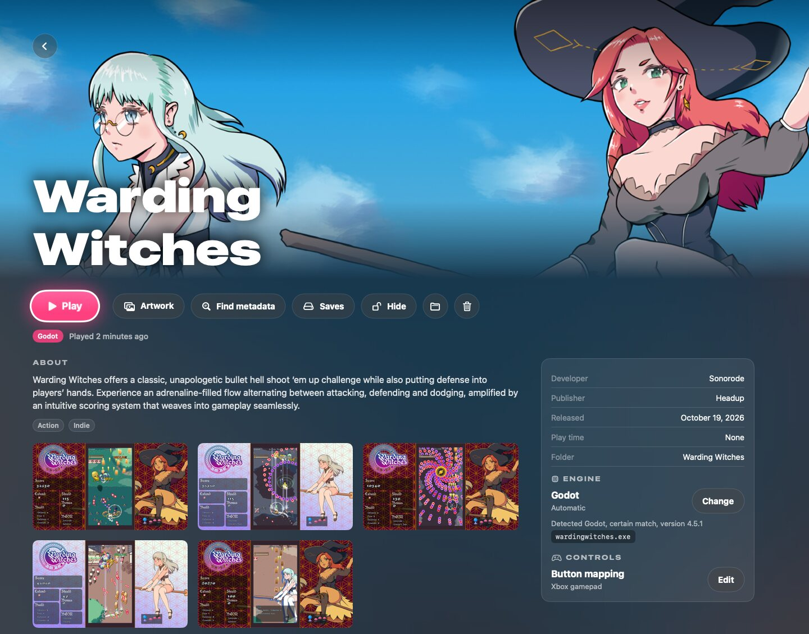
  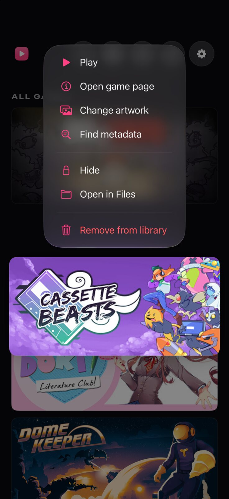
  <br><sub>Mac: a game page &nbsp;·&nbsp; iPhone: a game's long-press menu</sub>
</p>

<p align="center">
  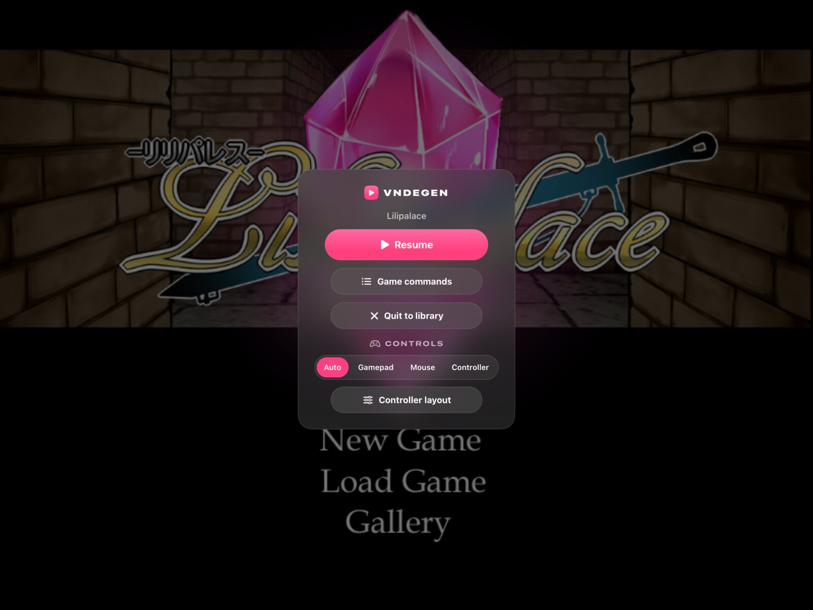
  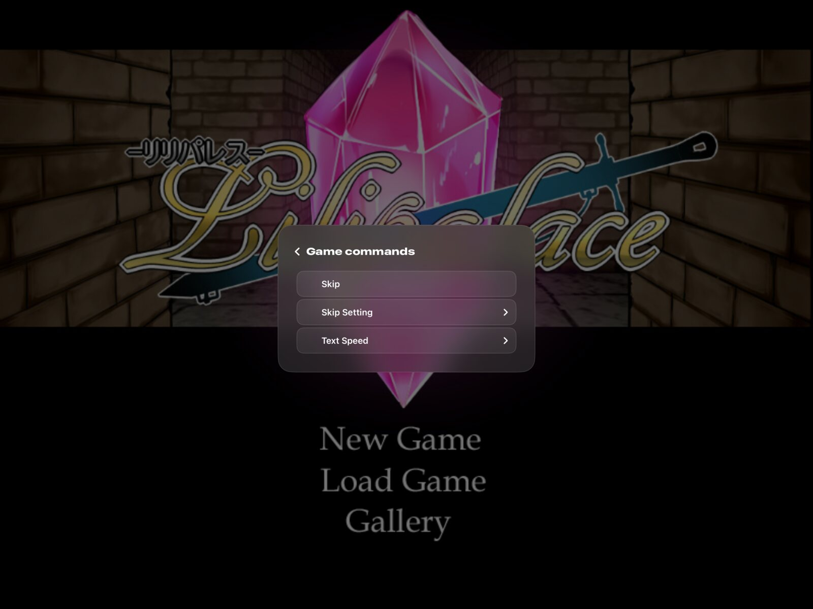
  <br><sub>iPad: the VNDegen menu and its Game commands</sub>
</p>

## Hidden games

Games marked Hide leave the library until it is unlocked with Face ID, Touch ID, or the app passcode, and the library locks again when VNDegen goes to the background. [docs/library.md](docs/library.md#hidden-games) has the details.

<p align="center">
  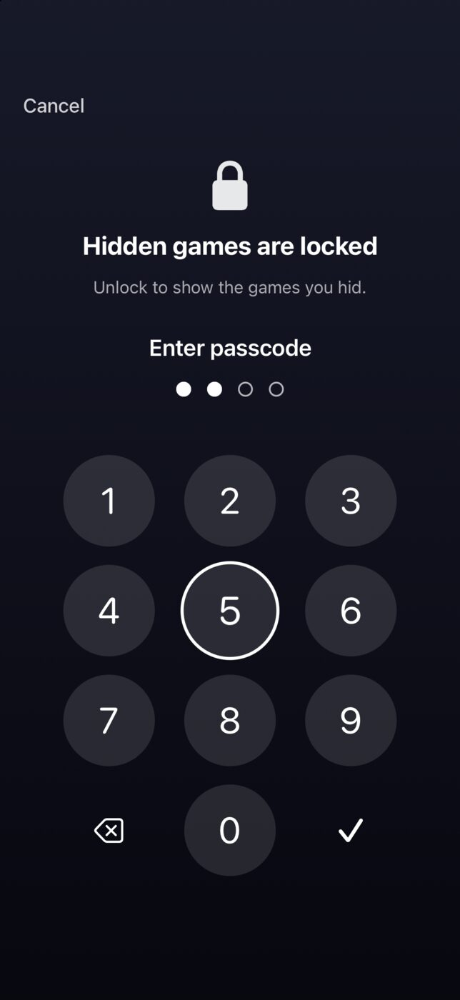
  <br><sub>iPhone: the passcode keypad, with controller focus on one key</sub>
</p>

## Controls

In a game, every button from the touch gamepad or a real controller reaches the game as an Xbox controller button, read by the game's own gamepad support. Engines that read no gamepad start with a layout of keys and clicks instead: "Visual novel" for most visual novel engines, such as KiriKiri, NScripter, Artemis, SiglusEngine, AliceSoft, EAGLS, IPAC, Ikura GDL and SystemAoi, "Mouse" for Flash, Twine and PJADV, "RPG Maker controls" for RPG Maker XP, VX, and VX Ace, and Steam's Keyboard and Mouse layout for TyranoScript. Each game has its own control method (Automatic, Touch gamepad, Mouse, or Controller) and its own button mapping, where any button can send another button, a key, a click, the mouse wheel, or mouse movement.

| In the library and the VNDegen menu | Controller | Keyboard |
|---|---|---|
| Move | D-pad or left stick | Arrows or WASD |
| Confirm | A | Return or Space |
| Cancel | B | Escape or Backspace |
| Menu | Y or Menu | Tab |
| Open the focused game's menu | X | |
| Previous and next page | LB and RB | Q and E, or Page Up and Page Down |
| Open the VNDegen menu in a game | Home, and View while the menu is open | Backtick (`` ` ``) |

A controller's Home button, the touch gamepad's house button, the small menu button in the corner, and the backtick always open the VNDegen menu, so a mapping cannot lock you out. On a Mac, the window's close, minimise and zoom buttons hide while a game plays and show again while the menu is open. The small menu button starts in the top right corner. Drag it to move it, and it settles in the nearest corner, which the game keeps the next time it starts. With VoiceOver, its Move to next corner action steps it round the corners. [docs/controls.md](docs/controls.md) has every layout, the controller layout sheet, and each engine's keys.

<p align="center">
  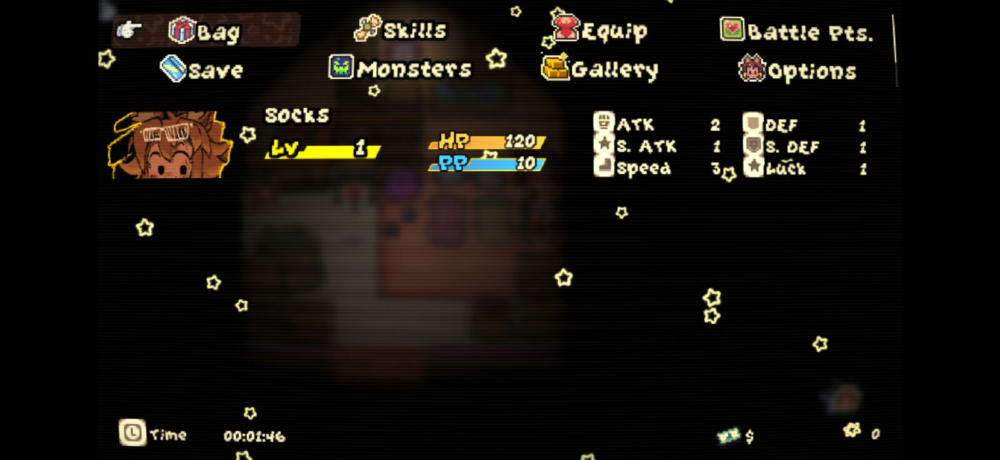
  <br><sub>iPhone in landscape: No Socks RPG</sub>
</p>

<p align="center">
  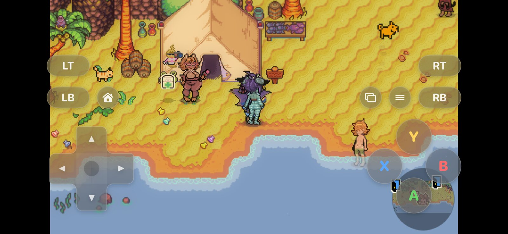
  <br><sub>iPhone in landscape: the touch gamepad over No Socks RPG</sub>
</p>

## Documentation

- [library.md](docs/library.md): adding games, library folders, layouts, hidden games, and metadata sources
- [controls.md](docs/controls.md): control methods, controller layouts, a game's dialogs, and Game commands
- [cheats.md](docs/cheats.md): what the Cheats page does in each engine
- [engines.md](docs/engines.md): each engine's detection, runtime, saves, and known limits, with more in [rgss.md](docs/rgss.md), [artemis.md](docs/artemis.md), [siglus.md](docs/siglus.md), [godot.md](docs/godot.md), [flash.md](docs/flash.md), [htmlvn.md](docs/htmlvn.md), [construct.md](docs/construct.md), [nscripter.md](docs/nscripter.md), [wolfrpg.md](docs/wolfrpg.md), [system3.md](docs/system3.md), [system4.md](docs/system4.md), [nekosdk.md](docs/nekosdk.md), [yuris.md](docs/yuris.md), [n2system.md](docs/n2system.md), [tmrhiro.md](docs/tmrhiro.md), [ipac.md](docs/ipac.md), [ikura.md](docs/ikura.md), [eagls.md](docs/eagls.md), [exhibit.md](docs/exhibit.md), [bruns.md](docs/bruns.md), [age.md](docs/age.md), [bsx.md](docs/bsx.md), [pjadv.md](docs/pjadv.md), [anim.md](docs/anim.md), [systemaoi.md](docs/systemaoi.md), and [unity.md](docs/unity.md)
- [video.md](docs/video.md): movie decoding and the see-through clip converter
- [ludusavi.md](docs/ludusavi.md): setting up and using Ludusavi backups
- [fonts.md](docs/fonts.md): the Windows font substitutes
- [frame-rate.md](docs/frame-rate.md): frame rate checks of each engine
- The `*-cleanroom.md` files beside each engine's notes: where the knowledge behind VNDegen's own runtimes came from
- [development.md](docs/development.md): building, the project layout, and adding an engine
- [roadmap.md](docs/roadmap.md) and [releases/](docs/releases/): the plan and each release's notes

## License

VNDegen's own code is under the MIT License (`LICENSE`). The engines and libraries built into the app keep their own licenses. A build that includes a GPL component is distributed as a whole under that GPL. Settings, Licenses lists the license of every third-party component in the app, and where to get the source. The LGPL libraries are in frameworks of their own, and [docs/relinking.md](docs/relinking.md) says how to replace one; each release attaches their exact source. This is not legal advice.
