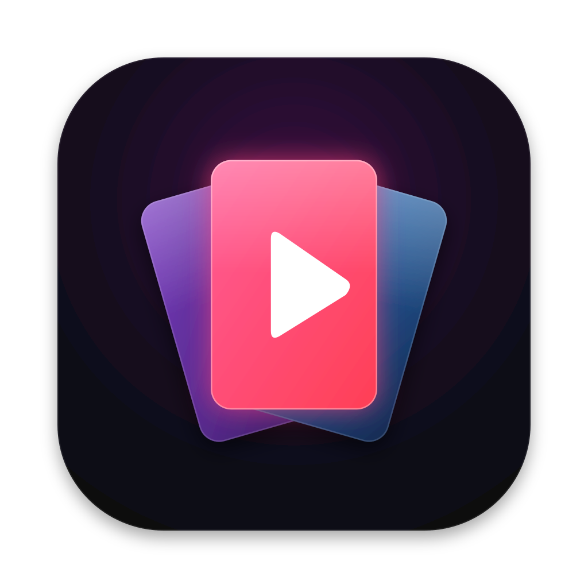
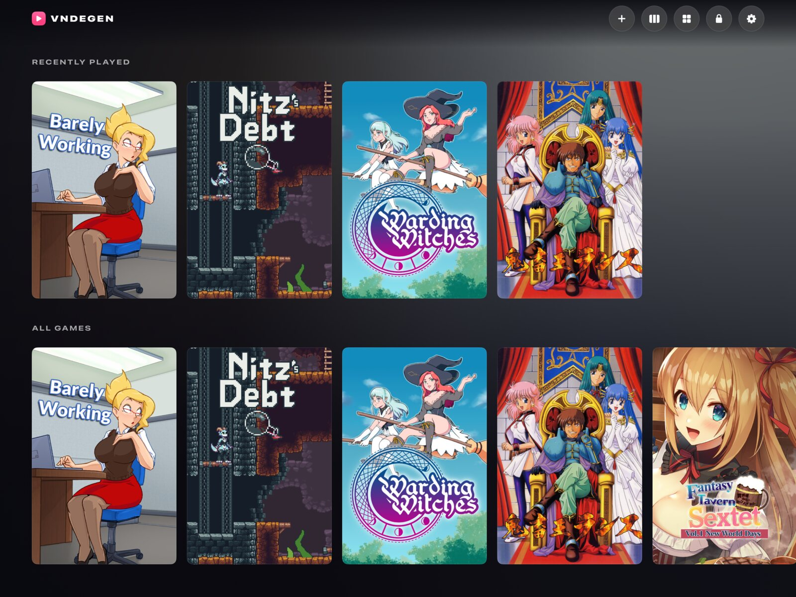
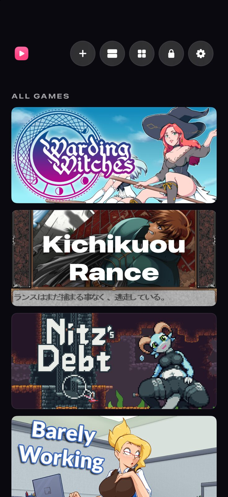
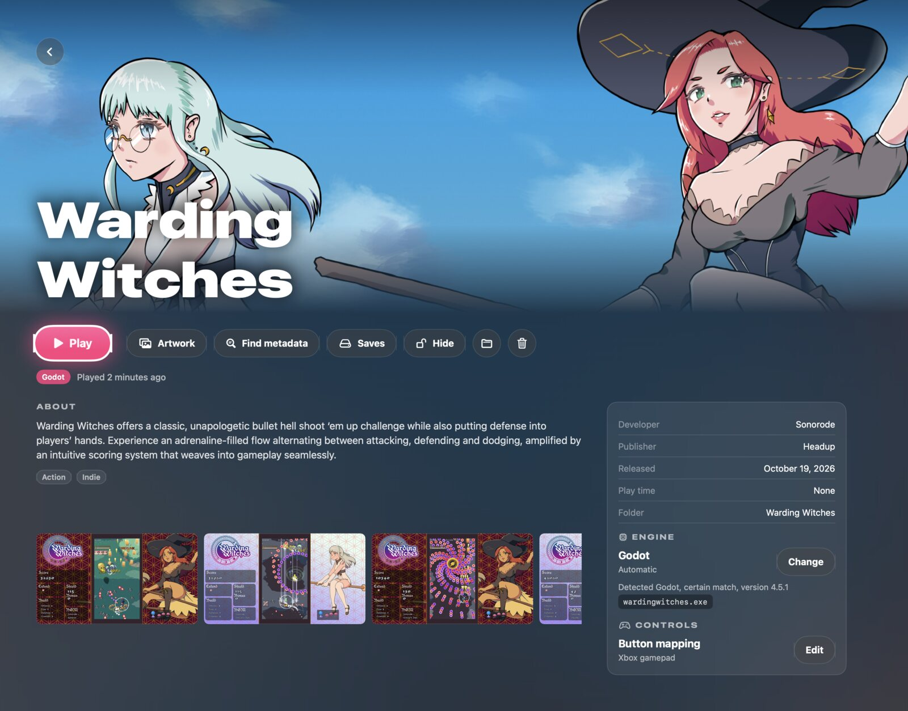
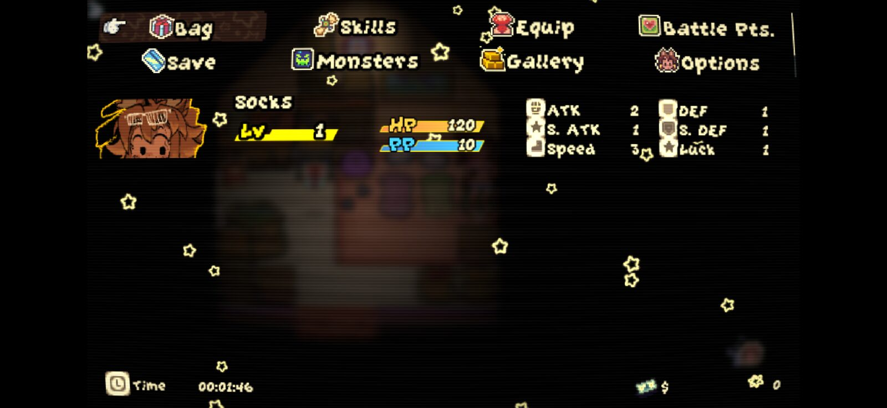
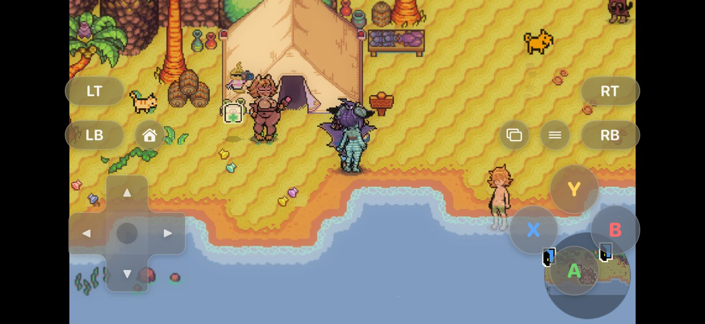
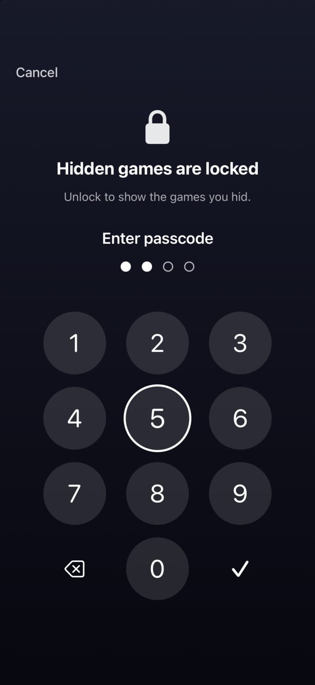

# VNDegen

VNDegen runs visual novel and RPG Maker games natively on Mac, iPhone, and iPad. Copy a game's folder into the library and VNDegen detects its engine and lists it in a game hub modeled on Steam's Big Picture mode. Each game shows its artwork, and Play starts it.

The PC games run unmodified. VNDegen does not convert or repack them, and their saves stay compatible with the PC versions.

<p align="center">
  
</p>

<p align="center">
  
  
</p>

## Features

- **Engine detection.** Each engine is a plugin that recognizes its own files, such as `js/rmmz_core.js` for RPG Maker MZ. The game page shows the detected engine and the file that identified it. Games with no detected engine can be assigned one by hand.
- **Artwork and metadata.** VNDegen fetches capsule, hero, logo, header, and icon art plus descriptions, developers, release dates, and genres from the Steam store, SteamGridDB, IGDB, and VNDB. Every artwork slot can be replaced with another source's image or one imported from Photos or Files.
- **One layout per device.** The hub adapts to iPhone portrait and landscape, both iPhone Duo displays, iPad, and Mac windows of any size. Folding the Duo or rotating the iPad keeps your place. On iPad, VNDegen also runs in a window of its own, at any size iPadOS allows. The library, game pages, the in-game menu, the touch gamepad, and every engine fit the window and keep clear of its window controls.
- **Every input method.** Touch, mouse and keyboard, and game controllers all drive both the hub and the games. A controller alone reaches every screen, including Settings, the button mapping editor, adding a game, and the lock screen, and its text fields open an on-screen keyboard the controller types on. Each game has its own control method (Automatic, Touch gamepad, Mouse, or Controller), switchable from the in-game menu. Mouse works by touch, where a tap clicks right where it lands, or by a cursor you drag like a trackpad. Controller shows no overlay and ignores touches unless its Mouse checkbox is on. Every button reaches games as an Xbox controller button by default, except in KiriKiri, TyranoScript, and Flash games, which start with Steam's Keyboard and Mouse layout. Each game also has its own button mapping: any overlay or controller button can send another Xbox button, a keyboard key, a mouse click, the mouse wheel, mouse movement, or the on-screen keyboard.
- **Hidden games.** Games marked Hide disappear from the library until it is unlocked with Face ID, Touch ID, or an app passcode. The library locks again when the app goes to the background.
- **In-game orientation.** On iPhone, games lock to landscape by default. On iPad the lock applies only when VNDegen is full screen. In a window, tiled or not, a game follows the window's shape. The setting can be changed globally or per game: Landscape, Portrait, or Follow device.
- **Ludusavi saves.** VNDegen backs up and restores [Ludusavi](https://github.com/mtkennerly/ludusavi) backups on your SMB share, the one Ludusavi's cloud sync uses, so saves move between VNDegen and the PC copies Ludusavi manages. It matches games by itself, offers newer saves before a game starts, and restores can be undone.
- **Windows fonts.** Games that ask for MS Gothic, MS Mincho, Arial, Tahoma, and other Windows fonts by name get free fonts with the same metrics, as under Proton, so their text wraps and fits as designed. Chinese and Korean fonts are a download in Settings.
- **Hardware rendering.** Web-based engines render through WebGL on Metal. Ren'Py and Godot 3 render through Apple's OpenGL on Mac and through ANGLE's Metal backend on iPhone and iPad. Godot 4 renders on Metal.

<p align="center">
  
</p>

## Engines

| Engine | Detected by | Platforms |
|---|---|---|
| RPG Maker MZ | `js/rmmz_core.js` | Mac, iPhone, iPad |
| RPG Maker MV | `js/rpg_core.js` or `www/js/rpg_core.js` | Mac, iPhone, iPad |
| TyranoScript and TyranoBuilder | `tyrano/` with `data/scenario/`, including NW.js and Electron builds (also inside `app.asar`) | Mac, iPhone, iPad |
| Ren'Py 6.99 to 8 | `renpy/` beside a `game/` folder holding `.rpy`, `.rpyc`, or `.rpa` files, also one or two folders down | Mac, iPhone, iPad |
| RPG Maker XP, VX, and VX Ace | `Game.ini` beside `Game.rgssad`, `Game.rgss2a`, or `Game.rgss3a`, or beside `Data/Scripts.rxdata`, `.rvdata`, or `.rvdata2`, also one or two folders down | Mac with Apple silicon, iPhone, iPad |
| KiriKiri 2 and KiriKiri Z | `data.xp3`, a `data/` folder holding `startup.tjs`, or an archive appended to the game's `.exe`, beside the `.exe` and up to two folders down | Mac, iPhone, iPad |
| Godot 3 and Godot 4 | a `.pck` file beside the game's `.exe`, or a pack inside the `.exe`, up to two folders down | Mac with Apple silicon, iPhone, iPad |
| Flash (ActionScript 1, 2, and 3) | A Flash projector `.exe` with the movie appended, a `.swf` movie, or an HTML page that launches movies, up to four folders down | Mac, iPhone, iPad |
| NScripter | `nscript.dat`, or `0.txt` or `00.txt` beside an `.nsa`, `.ns2`, or `.sar` archive or NScripter's own files, up to two folders down | Mac, iPhone, iPad |

RPG Maker MV and MZ games ship as HTML5 inside NW.js. VNDegen runs them in WebKit with a small NW.js compatibility layer, so plugins that call Node's `fs`, `path`, or `nw.gui` keep working. The layer also means saves are written as `save/*.rmmzsave` exactly like the PC version, and encrypted images and audio, Effekseer effects, and WebM movies all work. WebKit can't decode Ogg Vorbis, so MZ uses the decoder it ships with, and MV games that ship only Ogg audio, as most do, play it through VNDegen's own Ogg decoder, described below.

TyranoScript games run on the same WebKit host. Their saves stay in the game folder as on PC, except for builds that save to browser storage, which VNDegen keeps per game. iOS cannot play Ogg, so VNDegen decodes Ogg Vorbis inside the game's page with libvorbis compiled to WebAssembly, the first time each track plays.

Ren'Py games run on Ren'Py's own engine. The Mac app bundles two official Ren'Py runtimes, 8.5.3 for Ren'Py 8 games and 7.8.7 for Ren'Py 7 and older games, and picks one from the game's `renpy/vc_version.py` or `renpy/__init__.py`, then its `lib/` folder names, then the engine's compiled files. Each game runs in its own process and window, which takes the hub window's place, and the hub comes back when the game quits. Saves and logs go to the game's data folder, and the game folder is never written to. A game copied from a PC with saves in `game/saves/` gets those copied in on its first launch.

On iPhone and iPad, Ren'Py 8.5.3 is built into the app and every Ren'Py game runs on it, inside VNDegen's window. Ren'Py 7 and 6.99 games run on it too, with fixes VNDegen applies in memory, such as dividing integers the Python 2 way in the game's own code. 15 of the 16 Ren'Py 7 games in the maintainer's library reached their main menu this way, and VNDegen ships that list. The page of a Ren'Py 7 game says whether it is known to work and, once it has run, whether it reached its main menu on this device. On Mac the game page's Ren'Py runtime option runs a game on the other runtime.

Ren'Py can't load saves made by a newer Ren'Py. VNDegen runs each game on the newest Ren'Py of its line, so saves made here may not load in the game's PC version, and the game's Saves page warns before a Ludusavi backup when that applies. VNDegen on other devices loads them. The exception is a Mac, which runs Ren'Py 7 games on Ren'Py 7.8.7, so it loads a Ren'Py 7 game's saves from an iPhone or iPad only once that game's Ren'Py runtime option is set to Ren'Py 8.5.3. A Ren'Py 7 game's persistent data, such as unlocked gallery images, is written so its PC version loads it.

RPG Maker XP, VX, and VX Ace games run on mkxp-z, an open-source reimplementation of RPG Maker's RGSS player, built into the app as a libretro core with Ruby 3.3 compiled to plain C, so it needs no JIT. The game draws inside VNDegen's window through ANGLE on Metal, so the VNDegen menu and touch controls work as for the other engines. Packed games (`Game.rgss3a` and its older forms) and unpacked ones both work, as do MIDI music, through a public domain soundfont, and the Windows API calls many games make, which mkxp-z and VNDegen emulate. Saves go to the game's data folder. Saves copied in with a PC game in its folder still load, and the game folder is never written to. On a Mac with an Intel processor these games show as unsupported, since the engine is built for Apple silicon only. Games that need a Windows DLL VNDegen doesn't emulate lose that DLL's feature, and some games written for RPG Maker's old Ruby versions may stop with an error. The game page then says what the error was.

Many RPG Maker games use the RTP, a set of stock graphics, sounds, and fonts that the PC player installs once instead of every game shipping it. Its license doesn't let VNDegen include it. When a game needs an RTP that isn't installed, its page offers Download and install, which fetches the official installer from the RPG Maker website (rpgmakerweb.com), checks it against the SHA-256 VNDegen expects, shows the RTP's license to accept, and unpacks it inside the app on Mac, iPhone, and iPad. The RTP is then shared by every game that needs it. Import from folder takes an RTP folder copied from a PC instead, such as `C:\Program Files (x86)\Common Files\Enterbrain\RGSS3\RPGVXAce`. The XP RTP is 23 MB to download, VX's 37 MB, and VX Ace's 195 MB. Nothing downloads until you tap the button.

KiriKiri games run on krkrsdl3, an SDL3 port of the KiriKiri engine, which VNDegen builds into the app. The game draws inside VNDegen's window, composited on the CPU and shown through Metal, so the VNDegen menu and touch controls work as for the other engines. Saves stay in the game's `savedata/` folder as on PC. A game that saves to the Windows AppData or Documents folder saves to its data folder instead, and Ludusavi backups from Windows or a Steam Deck restore there. Movies play, in the formats KiriKiri games ship: MPEG-1 and MPEG-2, WMV, and H.264 and HEVC, which decode in hardware. Encrypted archives work without any per-game setting: VNDegen recognizes the common ciphers by the checksums inside the archive, and tells you when a game uses one it doesn't know. Common Windows plugins are built in, including `extrans`, `layerExDraw`, `layerExSave`, and Steam builds' `krkrsteam`. Known limits: sound effects and music stored as MP3 don't play, AlphaMovie (`.amv`) animations don't show, and a KiriKiri game that is still starting with a question on screen when the Mac logs out or shuts down doesn't save its settings from that moment.

Godot games run on Godot itself, which VNDegen builds into the app twice: Godot 4.7 runs every Godot 4 game, and Godot 3.6 every Godot 3 game. A game's pack loads unchanged, from its `.pck` or from inside its `.exe`, and games exported with older Godot versions run too, such as Godot 4.2 to 4.5 and Godot 3.3 and 3.5. The game draws inside VNDegen's window: Godot 4 through Metal on Mac, iPhone, and iPad, and Godot 3 through Apple's OpenGL on Mac and through ANGLE's Metal backend on iPhone and iPad. Controllers reach games as an Xbox controller, and touches and the mouse as Godot's mouse. Saves go where the PC version keeps them: `user://` is under the Windows AppData folder's stand-in in the game's data folder, so Ludusavi backups from Windows, a Steam Deck, or Godot's Linux and Mac builds restore there, and games that save beside their `.exe` save in their own folder. Games built with Steam through GodotSteam run as Steam does offline, with the player signed in, and games that also ship Epic Online Services for their Epic Games Store build run without it. Packs encrypted with a key built into the game's own copy of Godot run too: VNDegen finds the key in the game's `.exe`. Games that can't run say why on their page: games that need other GDExtension or GDNative libraries, which are Windows code, and encrypted games whose key VNDegen doesn't find. Godot C# games aren't supported. `docs/godot.md` has the details and the known limits.
Flash games run in Ruffle, a Flash Player written in Rust, built for the web and run on the same WebKit host with WebGL. VNDegen plays a game's Windows projector (`Game.exe` with the movie appended) without unpacking it, a `.swf` movie, or a collection's own HTML menu page. Movies a game loads, and its saves, are named as they are beside the PC executable. Saves are the `.sol` files Flash Player writes, kept in the game's data folder by the movie that made them, so saves from Flash Player or Ruffle on a PC restore through Ludusavi and load. ActionScript 3 support in Ruffle is less complete than for ActionScript 1 and 2, so some AS3 games may stop or misbehave. `docs/flash.md` has the details.

NScripter games run on VNDegen's own NScripter runtime, written in C++ for VNDegen from NScripter's documentation and the games' files, MIT licensed like the rest of the app. It draws on the CPU and shows its frames through Metal inside VNDegen's window. It reads the engine's archives, including bitmaps and entries its packer compressed, and plays Ogg, WAV, MP3 and NBZ sound, CD tracks from a game's `CD` folder, and MPEG-1 movies. Games that script part of their logic in Lua (NSLua) run on an embedded Lua 5.1. Saves are the PC engine's own files, byte for byte, in the game's save folder, so they move between VNDegen and a PC copy of the game, and Ludusavi backs them up. English translations whose patched engine wraps text between words get the same word wrap. Known limits: of the effect DLLs only the ones a test game uses are drawn, others crossfade, and NSLua's direct drawing functions aren't emulated. `docs/nscripter.md` has the details.

`docs/engine-survey.md` covers which other engines are common and how each could be supported.

## Adding games

Put each game in its own folder, named as you want it to appear. The folder name is the game's identity, so the same game copied to several devices keeps its artwork and settings on each.

- **iPhone and iPad:** open the Files app, then On My iPhone (or iPad), VNDegen, Games, and copy the game folders there.
- **Mac:** copy the game folders into `~/Games/VNDegen`. It sits outside `~/Documents` so iCloud Drive does not upload your games.
- **From an archive:** Add game in the library unpacks a zip, RAR, or 7z into the library. You can also drag an archive from Files or Finder onto VNDegen, or open it in VNDegen from the Files Share menu or with Open With on a Mac.
- **Archive copied into VNDegen's folder:** copy a zip, RAR, or 7z into On My iPhone (or iPad), VNDegen, or its Games folder. On a Mac, copy it into `~/Games/VNDegen`. The library lists it under Ready to import, and its Import button opens the import with the archive chosen. "Delete archive after import" starts on for these archives. Use this when choosing an archive, dropping it, or opening it in VNDegen does nothing, which happens on some sideloaded installs.

VNDegen rescans the folder on launch, on pull to refresh, with Rescan in Settings, and when you return to the app.

## Controls

In a game, the controller is an Xbox controller, except in engines with no gamepad support. Every button, from the touch gamepad or a real controller, reaches the game as the same Xbox button, and the game reads it with its own gamepad support. RPG Maker MV and MZ map a gamepad themselves, so A confirms, B cancels, X dashes, Y opens the menu, LB and RB turn pages, and the D-pad and left stick move. Like a real Xbox controller there, the Menu, View, and trigger buttons do nothing unless the game uses them.

KiriKiri, TyranoScript, and Flash read no gamepad, so their games start with "Keyboard and mouse", the layout of Steam's Keyboard and Mouse controller template. LB turns the mouse wheel down and RB turns it up, LT right clicks, RT left clicks, View is Tab, and Menu is Escape. The left stick is W, A, S, and D, and pressing it in is Shift. The right stick moves the pointer, faster the further it is pushed, and pressing it in left clicks. The D-pad is 1, 2, 3, and 4, and A, B, X, and Y are Space, E, R, and F. The controller's Share button is not used. The touch gamepad gets the same buttons and has no sticks, so pointing on a touch device uses the Mouse control method.

"Mouse" is another layout the mapping editor offers. Both sticks move the pointer, A and RT left click, X and LT right click, LB turns the wheel down and RB turns it up, B and Menu press Escape, and Y shows the on-screen keyboard. The D-pad, View, and pressing the sticks in keep their Xbox buttons. On a Mac the controller moves the Mac's own pointer, and on iPhone and iPad a pointer arrow shows where it is. On iPhone and iPad the on-screen keyboard types into the game, with Return and Backspace, until the button or the keyboard's own key hides it. A Mac has its hardware keyboard, which already types into the game, so Show keyboard does nothing there.

With the Xbox gamepad layout instead, a TyranoScript game reads the gamepad when it turns that on in its Config.tjs (`useGamepad`), and each button its KeyConfig.js binds does what the game says. VNDegen turns every other button into the engine's own action: A reads on or presses the focused button, B cancels, X skips while held, Y and Menu open the game's menu, LB opens the backlog, RB turns auto mode on and off, and the D-pad and left stick move the focus. A Ren'Py game reads the controller itself in Ren'Py's own layout. On iPhone and iPad a Ren'Py game takes touches directly, with no touch controls over it, so its game page offers no control method.

The touch gamepad has the D-pad, A, B, X, Y, LB, RB, LT, RT, View, and Menu. L3, R3, and the sticks come from a real controller.

| Action in the library and the VNDegen menu | Controller | Keyboard in the library |
|---|---|---|
| Move | D-pad or left stick | Arrows or WASD |
| Confirm | A | Return or Space |
| Cancel | B | Escape or Backspace |
| Menu | Y or Menu | Tab |
| Previous and next page | LB and RB | Q and E, or Page Up and Page Down |
| Open the VNDegen menu in a game (resume or quit to library) | Home, and View while the menu is open | Backtick (`` ` ``) |

A text field opens VNDegen's on-screen keyboard when you press A on it. A types the focused key, X deletes, LB toggles shift, RB switches to symbols, Y finishes, and B closes the keyboard without changes. In the button mapping editor, LB and RB jump between groups of buttons, and Reset returns the game to its engine's default layout. Remapping A or B never changes how the editor or the VNDegen menu respond. Adding a game by controller lists the archives in VNDegen's own folder (On My iPhone or On My iPad, VNDegen, on iOS). The Files and Photos pickers need touch or a mouse, and say so on screen.

While a game runs, the keyboard and mouse go straight to the game, which uses its own keys. For RPG Maker, MV and MZ as well as XP, VX, and VX Ace, those are the arrows, Z or Return, X or Escape, Shift, and Q and W. In a KiriKiri game on the Xbox gamepad layout, A is Return, B is a right click, Y and Menu are Escape, X holds Control, and L and R turn the mouse wheel, which opens and pages back through the message history, as in KAG3's own controls. A KiriKiri game's text fields get what the keyboard types, as on Windows.

Each game has its own button mapping. The VNDegen menu's Controls section and the game page's Controls section switch the control method and open the button mapping editor, which lists every Xbox button. Each button can send another Xbox button, a keyboard key, a left or right click, the scroll wheel up or down, mouse movement up, down, left, or right, Show keyboard, or nothing. A button or D-pad direction moves the pointer at a steady speed while held. Each stick also has a row that turns the whole stick into mouse movement, or back into a stick, in one step. Without a mapping, sticks are the controller's sticks. At the top of the editor, "Keyboard and mouse" applies the layout KiriKiri and TyranoScript games start with, "Mouse" the pointer layout above, and "RPG Maker controls" maps the buttons to the keys RPG Maker reads: A to Return, B to Escape, X to Shift, Y and Menu to X, LB to Q, RB to W, and the D-pad and left stick to the arrows. Return confirms in every RPG Maker, where XP uses Z for another button, and Escape and X both cancel and open the menu. "Xbox gamepad" clears every remap, so every button sends its own Xbox button. Ren'Py applies the mapping too, except mouse movement, the wheel, and Show keyboard, since Ren'Py reads the controller itself. A remapped touch button shows what it sends, for example "Esc".

A controller's Home button, the touch gamepad's house button, the small menu button in the corner, and the backtick always open the VNDegen menu, so a mapping cannot lock you out. Remaps saved by earlier versions, which sent actions such as Confirm, convert on first launch to what those actions sent in the game's engine, so remapped games play the same: the Return key in RPG Maker, the matching Xbox button in Ren'Py, and the same TyranoScript action in TyranoScript.

<p align="center">
  
  
</p>

## Fonts

PC games name Windows fonts that VNDegen can't ship. Like Proton, VNDegen bundles freely licensed fonts with the same metrics and gives each the Windows name the game asks for: Ume fonts for MS Gothic, MS PGothic, MS UI Gothic, MS Mincho, and MS PMincho, Liberation for Arial, Times New Roman, and Courier New, and DejaVu Sans Condensed for Tahoma. A device font with that name, such as Arial on Apple systems, comes first. Chinese and Korean games need Source Han Sans, which Settings, Fonts downloads from Adobe's release: 50.7 MB for Chinese and 26 MB for Korean. Games started after a download use it. One table, `Engines/Shared/fonts/fonts.tsv`, maps the names. The RPG Maker MV and MZ and TyranoScript engines read it through the `FontPack` module, and KiriKiri, RGSS, and other native engines through `Engines/Shared/vnfont.h`. [docs/fonts.md](docs/fonts.md) lists the fonts, where they come from, and how closely they match.

## Metadata sources

Steam and VNDB work without setup. SteamGridDB and IGDB need keys, entered in Settings, Metadata Sources. The keys are stored in the Keychain.

- **SteamGridDB:** an API key from your SteamGridDB profile preferences.
- **IGDB:** the client ID and secret of a Twitch developer application.

## Ludusavi

VNDegen reaches your Ludusavi backups on the SMB share that Ludusavi's cloud sync uses. It has rclone's own SMB code built in, the code Ludusavi's rclone runs on the PCs, so it works the same on iPhone, iPad, and Mac with nothing to install.

Set it up once in Settings, under Ludusavi backups:

1. Enter what Ludusavi's cloud settings show for its SMB remote: the host, the port (445 unless you changed it), and the username and password. Guest is on for a new setup and matches Ludusavi's `guest` username, which logs in with no password.
2. Enter the path from Ludusavi's cloud settings. It is the share, then the folder inside it, such as `games/Ludusavi`.
3. Tap Test Connection. VNDegen lists the folder and shows how many games it found. The test only reads.
4. Turn on Match my Ludusavi settings and enter the retention limits from Ludusavi's Other screen. On a Mac with Ludusavi installed, VNDegen reads them from Ludusavi's config.

The password stays on the device and out of VNDegen's settings file. On iPhone and iPad it is in the Keychain, for this device only. On a Mac it is in a file only your user can read, in VNDegen's Application Support folder, so app updates don't ask for your password. rclone gets it obscured, in a config that lives in memory and never touches an rclone.conf.

VNDegen never uploads with a sync. Ludusavi's upload is `rclone sync`, which deletes whatever the PC lacks. VNDegen only copies its new backup folder and then its mapping.yaml, so it never removes another device's backups.

VNDegen 0.4.0 connected over SSH and rsync. Its settings turn save sync off after the update, with a note in Settings, until you enter the share. VNDegen deletes the SSH key it made then.

Each game then finds its Ludusavi game by itself: by the Steam app ID in its metadata through Ludusavi's manifest, else by title. You can pick another on the game's Saves page. That page lists the game's backups with their date, source device, and kind, says whether the saves here or on the server are newer, and previews what a restore changes.

- **Restore** brings a backup down and copies it into the game's save folder, after keeping a copy of the current saves for Undo.
- **Back up now** writes a full or differential backup in Ludusavi's format, as Ludusavi would, with the same file paths as your existing backups, so Ludusavi restores it on the PC and Steam Deck. A game with no backup yet goes where the PC keeps it, under the Steam library the other backups use. With retention limits set, backups beyond them leave the backup list, as Ludusavi drops them. Their folders stay on the server until Ludusavi on a PC deletes them at its next backup of that game, because another device may still list them. Each device names its backup folders with an ID of its own, and VNDegen checks the server's backup list again right before it adds to it, so a backup from another device is not overwritten.
- **Before a game starts**, VNDegen asks when another device backed up newer saves, or when the saves changed both here and on the server.
- **Automatic backup** when a game closes is available and off by default. It skips a game whose saves changed in both places and leaves the choice to you.

Ludusavi on a PC that syncs its backup folder with rclone sees VNDegen's backups as changes in the cloud. When Ludusavi asks, choose to download them.

## Building

You need a Mac with Xcode 27, [XcodeGen](https://github.com/yonaskolb/XcodeGen) (`brew install xcodegen`), and Go (`brew install go`) for the rclone library that save sync uses. Run `scripts/build.sh` on that Mac:

```sh
scripts/build.sh test      # package tests
scripts/build.sh mac       # macOS app in build/mac/Build/Products/Debug/
scripts/build.sh ios-sim   # iOS simulator app in build/sim/Build/Products/Debug-iphonesimulator/
scripts/build.sh ipa       # unsigned build/VNDegen.ipa
```

Every app build first builds the KiriKiri engine into `build/kirikiri` with `scripts/kirikiri-engine.sh`, which does nothing when the engine is up to date. Its dependencies come from vcpkg, cached in `~/Library/Caches/VNDegen`, so the first build takes a while and later ones skip it. Every build first makes rclone's library from `Packages/VNDegenKit/Rclone/` for iPhone, iPad, the simulator, and the Mac (`scripts/rclone-runtime.sh`, kept until its sources or the Go version change). The macOS build downloads the two Ren'Py SDKs once, checks their SHA-256, and copies the trimmed runtimes into the app (`scripts/renpy-runtime.sh`, cached in `~/Library/Caches/VNDegen/renpy-sdk`). iOS builds also download Ren'Py's iOS libraries (renios) and link them into the app. `scripts/build.sh` does that before it builds; in Xcode, run `scripts/renpy-runtime.sh build/renpy ios` once first. `scripts/renpy-compat.sh <folder>` boots every Ren'Py game in a folder and prints which runtime each got and whether it reached its main menu. `scripts/renpy-hook-test.sh` checks VNDegen's Ren'Py hook on both runtimes.

Each bundled runtime writes the license notices of the code it links into `build/<runtime>/licenses/`: `scripts/rclone-runtime.sh` for rclone and its Go modules, `scripts/renpy-runtime.sh` for Ren'Py and its libraries, and `scripts/app-licenses.sh` for code built into the app itself. `scripts/build.sh` stops an app build when one of them wrote none. Where the texts come from is in `scripts/licenses/README.md`.

Every app build also builds the RPG Maker XP, VX, and VX Ace engine into `build/rgss` with `scripts/rgss-engine.sh`, which does nothing when the engine is up to date. It fetches mkxp-z's libretro core and ANGLE at pinned commits, applies the patches in `Engines/RGSS`, and caches its sources and tools in `~/Library/Caches/VNDegen/rgss`. The first build takes about an hour, most of it compiling Ruby to WebAssembly and back to C. It needs these Homebrew packages: `meson ninja cmake bison make automake autoconf libtool universal-ctags ruby@3.3 gnu-sed grep rsync`.

From another machine, `scripts/remote.sh` copies the checkout to a Mac over SSH and runs a command there. For example, `VNDEGEN_MAC=my-mac.local scripts/remote.sh scripts/build.sh ipa`. `scripts/sim.sh` boots a simulator, installs the app, copies a game in, and launches it.

### Installing a release

The [Releases](https://github.com/ChronoStriker1/vndegen/releases) page has a built IPA for iPhone and iPad and a zipped app for Mac, with install steps in each release's notes. `scripts/release.sh <version>` publishes a new one from `main`.

### Installing with AltStore or SideStore

Add this source in AltStore or SideStore to install VNDegen and get updates:

```
https://raw.githubusercontent.com/ChronoStriker1/vndegen/main/altstore/source.json
```

### Installing on iPhone or iPad

`scripts/build.sh ipa` makes an unsigned IPA. Sideloadly or AltStore signs and installs it with a free Apple ID. Apps signed that way expire after 7 days and need to be installed again.

## Project layout

```
App/                      app entry point, icons, Info.plist
Packages/VNDegenKit/
  Sources/VNCore/         shared types: games, the library, the engine plugin contract, input events
  Sources/WebRuntime/     shared host for HTML5 engines: WebKit view, game file serving, Node and NW.js layer
  Sources/EngineRPGMaker/ RPG Maker MV and MZ: detection, key mapping, save locations
  Sources/EngineTyrano/   TyranoScript: detection, Electron app.asar reading, save handling, controller mapping
  Sources/EngineRenPy/    Ren'Py: detection, runtime choice, the macOS helper process, the iOS in-app session, and the in-game hook
  Sources/CRenPy/         starts Python and runs Ren'Py inside the app on iOS
  Sources/RenPyCompat/    command-line boot test for a folder of Ren'Py games
  Sources/EngineKiriKiri/ KiriKiri: detection, save locations, and the in-process session on the engine framework
  Sources/CKiriKiri/      vnkk.h, the KiriKiri engine's C interface
  Sources/EngineRGSS/     RPG Maker XP, VX, and VX Ace: detection, the RTPs they need, saves, and the in-process session
  Sources/CRGSS/          vnrgss.h, the RGSS engine's C interface
  Sources/EngineGodot/    Godot 3 and 4: detection from the pack, save locations, and the in-process session
  Sources/CGodot/         vngd.h, the Godot engines' C interface
  Sources/RuntimePackages/ downloading, checking, and unpacking runtime packages such as the RTPs, with an Inno Setup reader
  Sources/FontPack/       the Windows font substitutes: the Swift API, and the Chinese and Korean font downloads
  Sources/CVNFont/        links to Engines/Shared/vnfont.[ch], the table reader every engine shares
  Sources/HubUI/          the library, game pages, settings, and the player screen
  Sources/GameInput/      game controllers, keyboard, and the touch overlay
  Sources/ControllerUI/   controller focus ring, the on-screen keyboard, and controller scrolling
  Sources/Metadata/       Steam, SteamGridDB, IGDB, and VNDB
  Sources/Lock/           Face ID, Touch ID, and passcode
  Sources/SaveSync/       Ludusavi backup and restore
  Sources/Rclone/         Swift calls into rclone's library
  Rclone/                 VNDegen's build of rclone: the Go library with the SMB and local backends
  Sources/ArchiveImport/  unpacking zip, RAR, and 7z archives into the library
Engines/RGSS/             the RGSS engine's frontend, patches, and build files; UPSTREAM.md lists the pinned sources
Engines/KiriKiri/         the vendored krkrsdl3 engine and VNDegen's C interface to it; UPSTREAM.md lists every change
Engines/Godot/            VNDegen's Godot modules, patches, and test host; UPSTREAM.md lists the pinned sources
Engines/Shared/           code and data every engine shares: the font table reader and the bundled fonts in fonts/
docs/                     engine survey and screenshots
scripts/                  build, remote build, simulator, and Ren'Py runtime helpers
project.yml               XcodeGen project definition
```

### Adding an engine

An engine is a type conforming to `EnginePlugin` in `VNCore/Engine.swift`:

- `detect(_:)` inspects a folder listing and returns a match with a confidence level.
- `makeSession(_:)` starts the game and returns an `EngineSession`, whose view the hub shows full screen and which receives controller input.
- `saveLocations(folder:dataDirectory:)` tells Ludusavi sync where the engine keeps saves.

Add the new plugin to the `engines` list in `App/VNDegenApp.swift`. The detector picks the most confident match among all registered plugins.

An engine that looks fonts up by Windows name resolves them with `vnfont_resolve` from `Engines/Shared/vnfont.h`. It compiles `vnfont.c` into the engine and passes `vnfont_init` the table and folders that `FontPack.table` and `FontPack.folders` give. See [docs/fonts.md](docs/fonts.md).

Windows ignores case in file and folder names, so Windows games often ask for `Img/Title.PNG` when the disk has `img/title.png`. iPhone and iPad disks, and case-sensitive Mac volumes, do not ignore case. Every engine plugin must find a game's files, folders, and archive members whatever case the game uses, for reads, writes, existence checks, and folder listings. A write to a name that exists in another case must replace that file rather than create a second one. Use the lookup of the engine's family rather than a new one:

- Swift code, including the web engines' `GameFolder`, uses `FileCase` in `VNCore/FileCase.swift`.
- C and C++ engines call `casepath_resolve` in `Engines/Shared/casepath.c` from their file layer, as `Engines/RGSS/host/vfs.c` and KiriKiri's `unix_file.cpp` do.
- Ren'Py's Python side uses `EngineRenPy/Support/filecase.py`, which `launcher.py` installs. `scripts/renpy-case-test.sh` tests it.

Each looks a name up as written first and reads a folder's listing only when that misses, so games that use the right case pay nothing.

Before a new engine plugin or a change to one ships, it passes the case check on its test games. `scripts/case-check.sh setup` copies each game into a library on a case-sensitive disk image with every name's case swapped. Each game must reach its title, start, save, and load there, on the Mac app and on an iPad simulator, both started with `-libraryRoot` on that library. The script's header has the commands. `scripts/build.sh test` runs the lookups' unit tests on a case-sensitive disk image too.

## License

VNDegen's own code is under the MIT License (`LICENSE`). The engines and libraries built into the app keep their own licenses. A build that includes a GPL component is distributed as a whole under that GPL. Builds with the RPG Maker XP, VX, and VX Ace engine include mkxp-z, which is GPL-2.0-or-later, so they are distributed under the GNU GPL, version 3. Version 3 rather than 2 because the iPhone and iPad app also contains Ren'Py's OpenSSL, whose Apache-2.0 license is compatible with GPL version 3 but not version 2. Their complete source is this repository, which builds the engine from the pinned sources in `Engines/RGSS/UPSTREAM.md`. Settings, Licenses lists the license of every third-party component in the app, and where to get the source. This is not legal advice.
