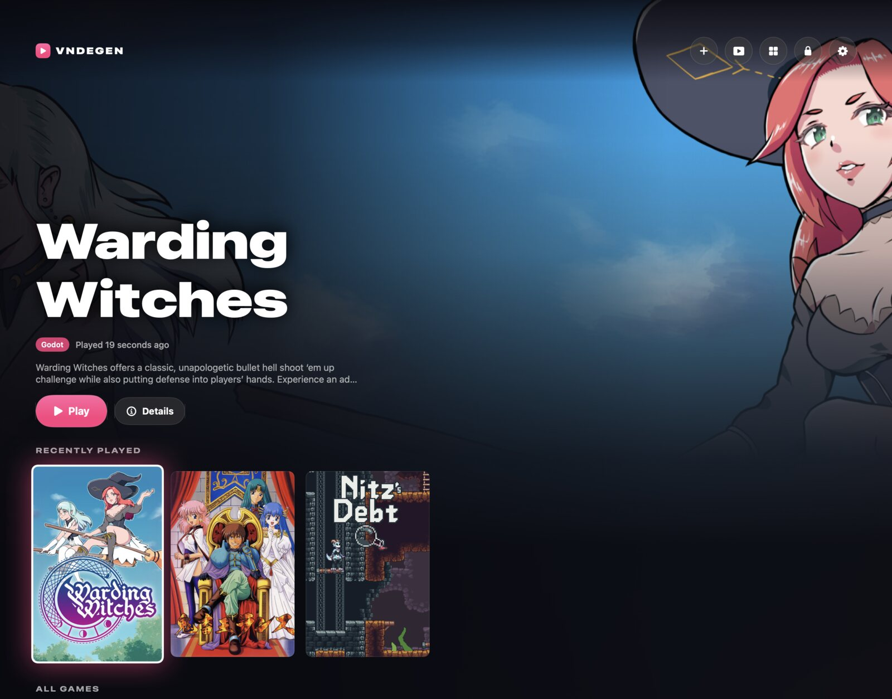
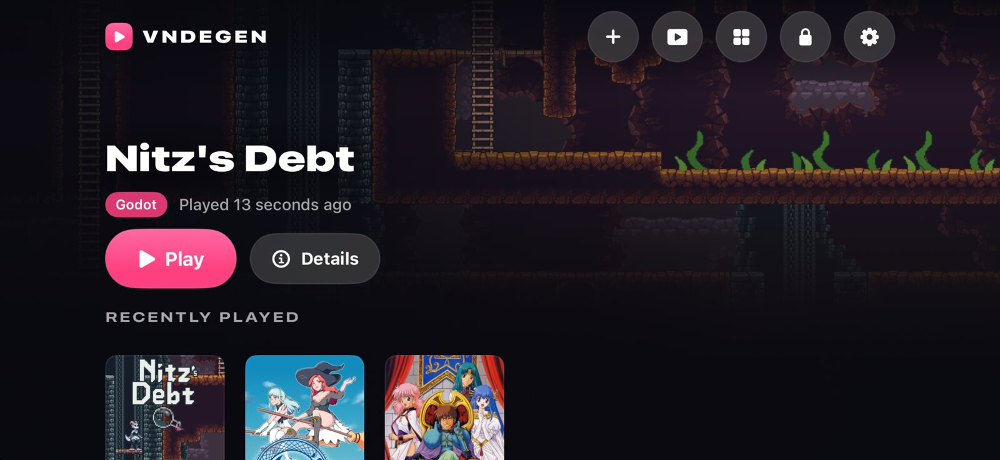
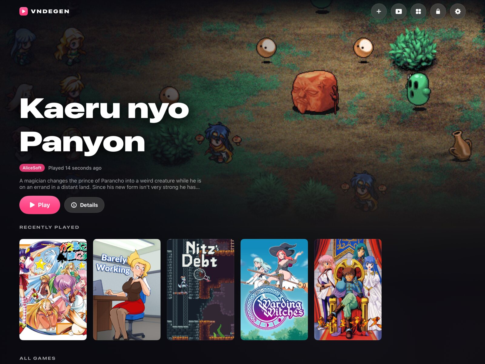
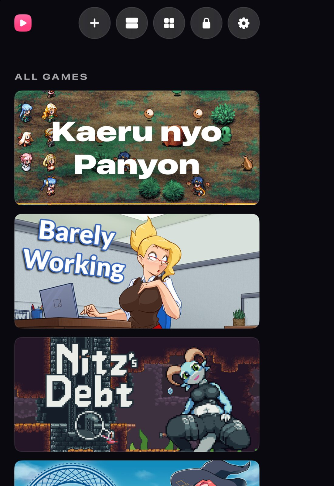
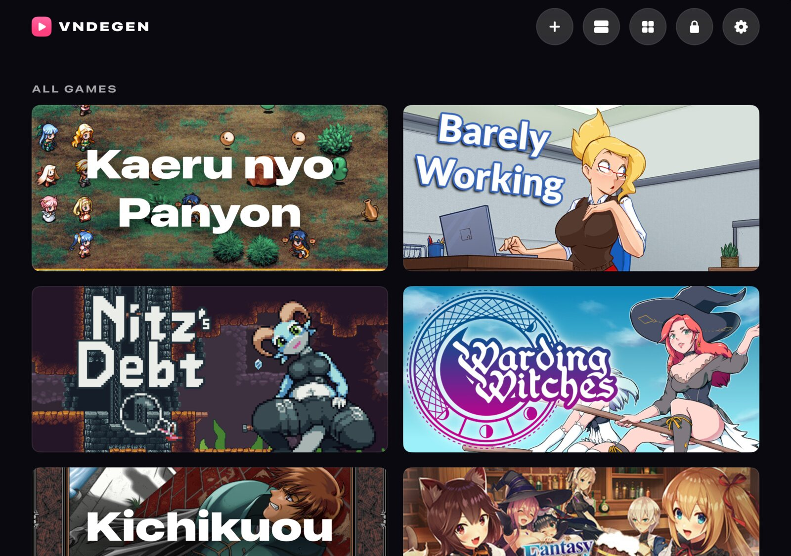
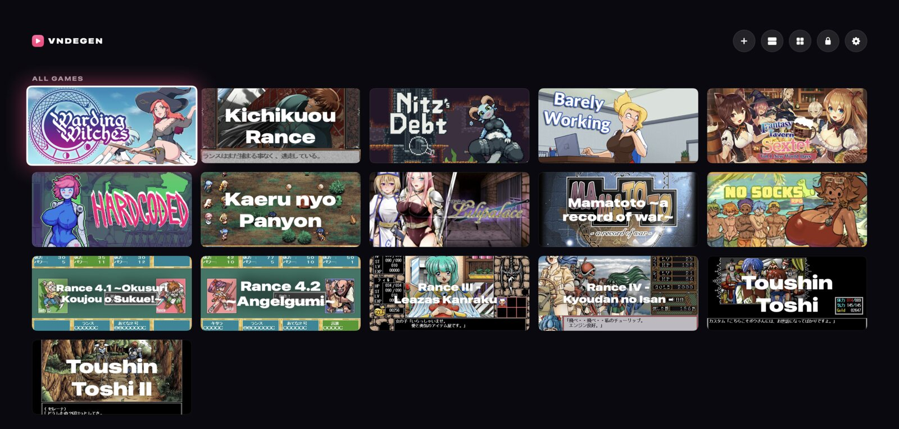
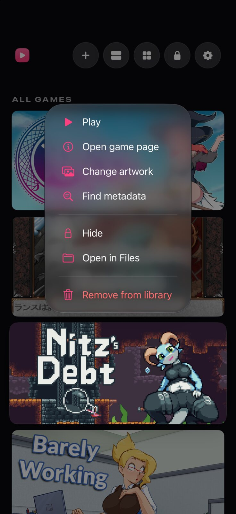
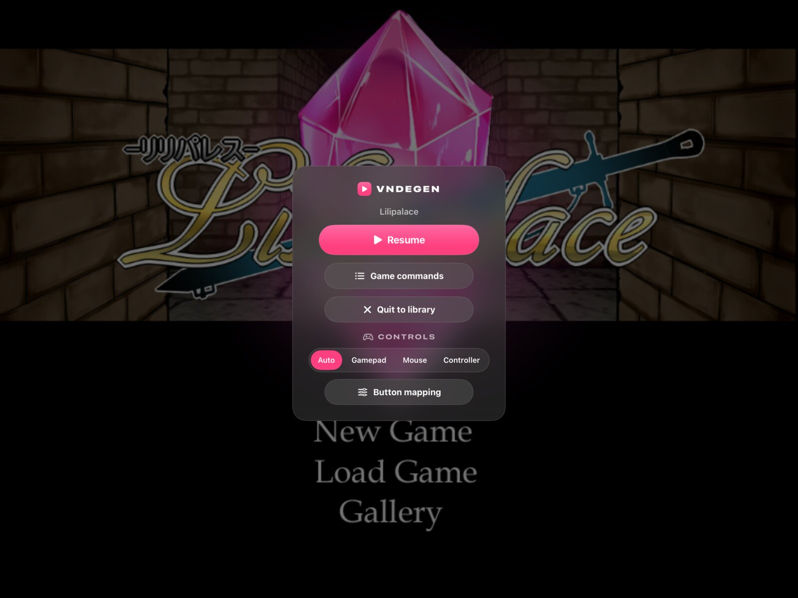

# VNDegen

VNDegen runs PC visual novels and RPG Maker games natively on Mac, iPhone, and iPad. Copy a game's folder into the library, and VNDegen detects its engine and lists it in a game hub modeled on Steam's Big Picture mode, with artwork from Steam and other sources. Play starts it.

The games run unmodified. VNDegen does not convert or repack them, and their saves stay compatible with the PC versions.

<p align="center">
  
  <br><sub>iPad: Capsule rows</sub>
</p>

<p align="center">
  
  
  <br><sub>iPhone in portrait: Header list &nbsp;·&nbsp; Mac: Featured</sub>
</p>

## Features

- **PC games on their own engines**, including RPG Maker, Ren'Py, KiriKiri, Godot, and Flash. See [Supported engines](#supported-engines).
- **Engine detection.** VNDegen recognizes each game by its files and shows which file identified it. You can assign an engine by hand. [Engines](docs/engines.md)
- **Artwork and metadata** from Steam, SteamGridDB, IGDB, and VNDB, and any art slot can be replaced. [Library](docs/library.md#artwork-and-metadata)
- **Three library layouts**, Header list, Capsule rows, and Featured, that fit iPhone portrait and landscape, iPhone Duo, iPad full screen or in a window, and Mac windows of any size. [Layouts](#layouts-on-each-device)
- **Touch, mouse and keyboard, and controllers** drive the hub and the games, with a per-game button mapping. [Controls](docs/controls.md)
- **More than one games folder**, such as an external drive or a server, and archives unpack straight into the library. [Library](docs/library.md#adding-games)
- **Game menu.** A long press, a right click, or X on a controller opens Play, Change artwork, Hide, Remove, and more. [Library](docs/library.md#the-game-menu)
- **Game commands.** Menus a game keeps in its window's menu bar, such as KiriKiri's, appear in the VNDegen menu. [Controls](docs/controls.md#game-commands)
- **Cheats** for RPG Maker MV, MZ, XP, VX, and VX Ace, and Wolf RPG Editor: gold, items, encounters, game speed, variables, and switches. [Controls](docs/controls.md#cheats)
- **Hidden games** behind Face ID, Touch ID, or a passcode. [Library](docs/library.md#hidden-games)
- **Ludusavi saves.** Back up and restore through your Ludusavi SMB share, so saves move between VNDegen and your PCs. [Ludusavi](docs/ludusavi.md)
- **Windows fonts.** Games that ask for MS Gothic, Arial, and other Windows fonts get free fonts with the same metrics. [Fonts](docs/fonts.md)
- **Hardware rendering** through Metal, directly or through WebGL, OpenGL, or ANGLE. [Engines](docs/engines.md)

## Layouts on each device

The view button in the top bar switches between Header list, Capsule rows, and Featured, and each device keeps its own choice.

<p align="center">
  
  <br><sub>iPhone in landscape: Featured</sub>
</p>

<p align="center">
  
  <br><sub>iPad: Featured</sub>
</p>

<p align="center">
  
  
  <br><sub>iPhone Duo folded, outer display &nbsp;·&nbsp; iPhone Duo unfolded, inner display: Header list</sub>
</p>

<p align="center">
  
  <br><sub>Mac, wide window: Header list</sub>
</p>

## Supported engines

| Engine | VNDegen detects | Platforms | Details |
|---|---|---|---|
| RPG Maker MZ | `js/rmmz_core.js` | Mac, iPhone, iPad | [engines.md](docs/engines.md#rpg-maker-mv-and-mz) |
| RPG Maker MV | `js/rpg_core.js` or `www/js/rpg_core.js` | Mac, iPhone, iPad | [engines.md](docs/engines.md#rpg-maker-mv-and-mz) |
| TyranoScript and TyranoBuilder | `tyrano/plugins/kag/kag.js`, also in NW.js and Electron builds | Mac, iPhone, iPad | [engines.md](docs/engines.md#tyranoscript) |
| Ren'Py 6.99 to 8 | `renpy/` beside a `game/` folder of scripts | Mac, iPhone, iPad | [engines.md](docs/engines.md#renpy) |
| RPG Maker XP, VX, and VX Ace | `Game.ini` beside a `Game.rgss*` archive or `Data/Scripts.*` | Mac, iPhone, iPad | [rgss.md](docs/rgss.md) |
| KiriKiri 2 and KiriKiri Z | `data.xp3`, `data/startup.tjs`, or an archive in the `.exe` | Mac, iPhone, iPad | [engines.md](docs/engines.md#kirikiri) |
| Artemis | a `.pfs` archive or a `system.ini` | Mac, iPhone, iPad | [artemis.md](docs/artemis.md) |
| Godot 3 and Godot 4 | a `.pck` file, or a pack inside the game's `.exe` | Mac with Apple silicon, iPhone, iPad | [godot.md](docs/godot.md) |
| Flash (ActionScript 1, 2, and 3) | a projector `.exe`, a `.swf`, or an HTML page that launches movies | Mac, iPhone, iPad | [flash.md](docs/flash.md) |
| NScripter | `nscript.dat`, or `0.txt` or `00.txt` beside NScripter archives | Mac, iPhone, iPad | [nscripter.md](docs/nscripter.md) |
| Wolf RPG Editor 2 and 3 | `Data.wolf`, `Data/BasicData`, or `Data/BasicData.wolf` | Mac, iPhone, iPad | [wolfrpg.md](docs/wolfrpg.md) |
| AliceSoft System 3.0 to 3.9 | `System39.ain` beside a scenario archive such as `RanceSA.ALD`, or `ADISK.DAT` | Mac, iPhone, iPad | [system3.md](docs/system3.md) |
| AliceSoft System 4 | an `.ain` code file beside `AliceStart.ini`, `System40.ini`, or `System40.exe` | Mac, iPhone, iPad | [system4.md](docs/system4.md) |

[docs/engines.md](docs/engines.md) has the exact detection rules and how each engine runs, saves, and what it can't do yet. Some RPG Maker XP, VX, and VX Ace games need the RTP, which VNDegen downloads from the RPG Maker website when you ask. [docs/engine-survey.md](docs/engine-survey.md) covers other engines and how each could be supported.

## Installing

- **Releases.** The [Releases](https://github.com/ChronoStriker1/vndegen/releases) page has an IPA for iPhone and iPad and a zipped app for Mac, with install steps in each release's notes.
- **AltStore or SideStore.** Add this source to install VNDegen and get updates:

  ```
  https://raw.githubusercontent.com/ChronoStriker1/vndegen/main/altstore/source.json
  ```

- **Sideloadly.** Sideloadly or AltStore signs and installs the IPA with a free Apple ID. Apps signed that way expire after 7 days and need to be installed again.

To build VNDegen yourself, see [docs/development.md](docs/development.md).

## Adding games

Put each game in its own folder, named as you want it to appear. The folder name is the game's identity, so the same game on several devices keeps its artwork and settings on each.

- **iPhone and iPad.** In the Files app, open On My iPhone (or iPad), VNDegen, Games, and copy the game folders there.
- **Mac.** Copy the game folders into `~/Games/VNDegen`, which sits outside `~/Documents` so iCloud Drive does not upload your games.
- **Archives.** Add game in the library unpacks a zip, RAR, or 7z. You can also drop an archive on VNDegen or open it in VNDegen from Files or Finder.
- **Other folders.** Settings, Library folders adds a folder of games from an external drive, a server, or elsewhere on the Mac.

VNDegen rescans on launch, on pull to refresh, and when you return to the app. [docs/library.md](docs/library.md) covers archives VNDegen can't open directly, other folders, removing games, and more.

<p align="center">
  
  
  <br><sub>Mac: a game page &nbsp;·&nbsp; iPhone: a game's long-press menu</sub>
</p>

<p align="center">
  
  
  <br><sub>iPad: the VNDegen menu and its Game commands</sub>
</p>

## Hidden games

Games marked Hide leave the library until it is unlocked with Face ID, Touch ID, or the app passcode, and the library locks again when VNDegen goes to the background. [docs/library.md](docs/library.md#hidden-games) has the details.

<p align="center">
  
  <br><sub>iPhone: the passcode keypad, with controller focus on one key</sub>
</p>

## Controls

In a game, every button from the touch gamepad or a real controller reaches the game as an Xbox controller button, read by the game's own gamepad support. Engines that read no gamepad, such as KiriKiri, TyranoScript, Flash, and Artemis, start with Steam's Keyboard and Mouse layout instead. Each game has its own control method (Automatic, Touch gamepad, Mouse, or Controller) and its own button mapping, where any button can send another button, a key, a click, the mouse wheel, or mouse movement.

| In the library and the VNDegen menu | Controller | Keyboard |
|---|---|---|
| Move | D-pad or left stick | Arrows or WASD |
| Confirm | A | Return or Space |
| Cancel | B | Escape or Backspace |
| Menu | Y or Menu | Tab |
| Open the focused game's menu | X | |
| Previous and next page | LB and RB | Q and E, or Page Up and Page Down |
| Open the VNDegen menu in a game | Home, and View while the menu is open | Backtick (`` ` ``) |

A controller's Home button, the touch gamepad's house button, the small menu button in the corner, and the backtick always open the VNDegen menu, so a mapping cannot lock you out. [docs/controls.md](docs/controls.md) has every layout, the mapping editor, and each engine's keys.

<p align="center">
  
  <br><sub>iPhone in landscape: No Socks RPG</sub>
</p>

<p align="center">
  
  <br><sub>iPhone in landscape: the touch gamepad over No Socks RPG</sub>
</p>

## Documentation

- [library.md](docs/library.md): adding games, library folders, layouts, hidden games, and metadata sources
- [controls.md](docs/controls.md): control methods, layouts, button mapping, Game commands, and cheats
- [engines.md](docs/engines.md): each engine's detection, runtime, saves, and known limits
- [ludusavi.md](docs/ludusavi.md): setting up and using Ludusavi backups
- [fonts.md](docs/fonts.md): the Windows font substitutes
- [development.md](docs/development.md): building, the project layout, and adding an engine
- [roadmap.md](docs/roadmap.md) and [releases/](docs/releases/): the plan and each release's notes

## License

VNDegen's own code is under the MIT License (`LICENSE`). The engines and libraries built into the app keep their own licenses. A build that includes a GPL component is distributed as a whole under that GPL. Settings, Licenses lists the license of every third-party component in the app, and where to get the source. This is not legal advice.
