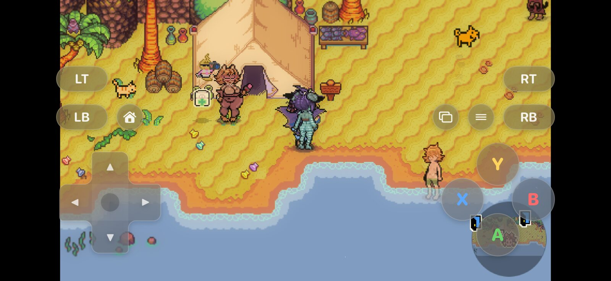
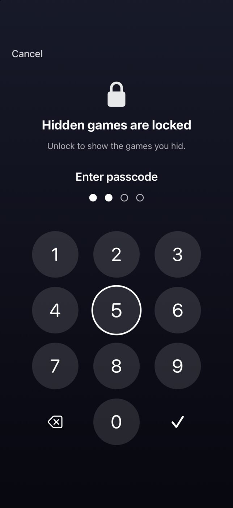
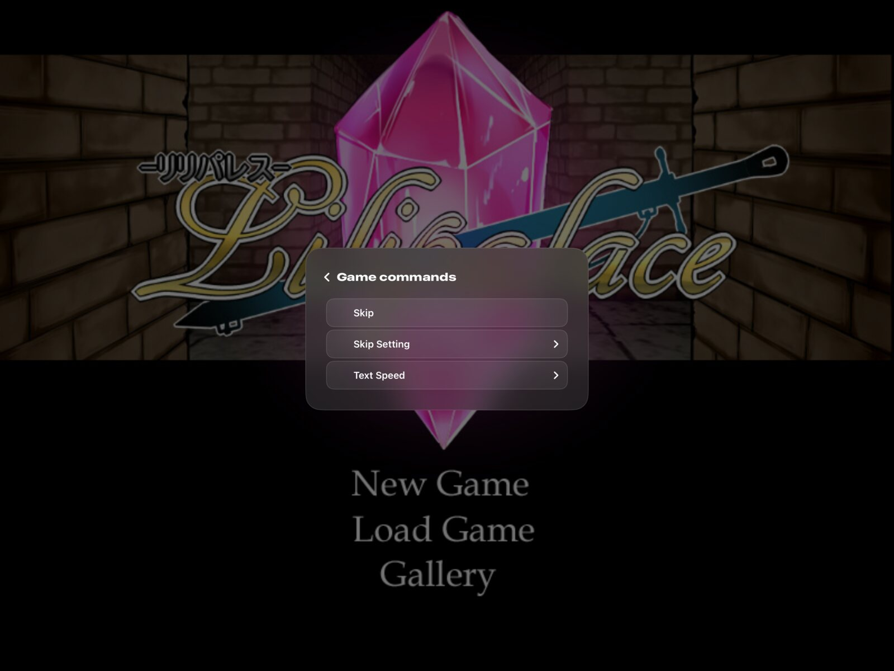

# Controls

Touch, mouse and keyboard, and game controllers all drive both the hub and the games. A controller alone reaches every screen, including Settings, the controller layout sheet, adding a game, and the lock screen, and its text fields open an on-screen keyboard the controller types on.

  
  

## Control methods

Each game has its own control method (Automatic, Touch gamepad, Mouse, or Controller), switchable from the in-game menu. Mouse works by touch, where a tap clicks right where it lands, or by a cursor you drag like a trackpad. Controller shows no overlay and ignores touches unless its Mouse checkbox is on.

The touch gamepad has the D-pad, A, B, X, Y, LB, RB, LT, RT, View, and Menu. L3, R3, and the sticks come from a real controller.

On a phone held upright, and on an iPad or an iPad window that is taller than it is wide, the game moves to the top of the screen and the touch controls fill the space below it, so none of them covers the game. The game keeps its shape. A 4:3 game fills the space above the controls, and a wider game fills the width with a dark band above and below it. With the cursor mouse style, under Mouse or Controller, the cursor still moves when you drag anywhere on the screen, and its Home button sits below the game. Mouse by touch, and Controller without a cursor, have no overlay, so the game stays in the middle of the screen. In landscape the controls sit over the game as before.

## Buttons in games

In a game, the controller is an Xbox controller, except in engines with no gamepad support. Every button, from the touch gamepad or a real controller, reaches the game as the same Xbox button, and the game reads it with its own gamepad support. RPG Maker MV and MZ map a gamepad themselves, so A confirms, B cancels, X dashes, Y opens the menu, LB and RB turn pages, and the D-pad and left stick move. Like a real Xbox controller there, the Menu, View, and trigger buttons do nothing unless the game uses them.

KiriKiri, NScripter, Artemis, and AliceSoft read no gamepad, so their games start with "Visual novel". A presses Return, which reads on and presses the focused button. B right clicks, which opens the game's menu or hides the text. X holds Control, which skips in games that skip on it. Y and Menu press Escape. LB turns the mouse wheel up, which opens the message history and pages back through it, and RB turns it down, which pages forward and reads on. The D-pad and the left stick are the arrow keys. LT right clicks, RT left clicks, View is Tab, and pressing the left stick in is Shift. The right stick moves the pointer, faster the further it is pushed, and pressing it in left clicks. The controller's Share button is not used. The touch gamepad gets the same buttons and has no sticks, so pointing on a touch device uses the Mouse control method.

Flash games are mostly played with the mouse, and Flash read no gamepad, so they start with "Mouse", described below. TyranoScript games start with "Keyboard and mouse", the layout of Steam's Keyboard and Mouse controller template. LB turns the mouse wheel down and RB turns it up, LT right clicks, RT left clicks, View is Tab, and Menu is Escape. The left stick is W, A, S, and D, and pressing it in is Shift. The right stick moves the pointer and pressing it in left clicks. On the D-pad, up is 1, right is 2, down is 3, and left is 4, and A, B, X, and Y are Space, E, R, and F. Any game can pick Keyboard and mouse.

RPG Maker XP, VX, and VX Ace games start with "RPG Maker controls", the keys RPG Maker reads, described below. LT, RT, and View press A, S, and D, the keys of RPG Maker's X, Y, and Z buttons, which games use for things such as a message log, hiding the message window, or a key a scene asks for by name. Wolf RPG Editor games start with "Xbox gamepad", which Wolf turns into its keys: A is Z, which confirms, B, Y, and Menu are X, which cancels and opens the menu, X is Shift, the D-pad and left stick move, LB and RB turn the wheel, and RT holds Control, which many Wolf games read to skip messages.

"Mouse" is another built-in layout. Both sticks move the pointer, A and RT left click, X and LT right click, LB turns the wheel down and RB turns it up, B and Menu press Escape, and Y shows the on-screen keyboard. The D-pad, View, and pressing the sticks in keep their Xbox buttons. On a Mac the controller moves the Mac's own pointer, and on iPhone and iPad a pointer arrow shows where it is. On iPhone and iPad the on-screen keyboard types into the game, with Return and Backspace, until the button or the keyboard's own key hides it. A Mac has its hardware keyboard, which already types into the game, so Show keyboard does nothing there.

With the Xbox gamepad layout instead, a TyranoScript game reads the gamepad when it turns that on in its Config.tjs (`useGamepad`), and each button its KeyConfig.js binds does what the game says. VNDegen turns every other button into the engine's own action: A reads on or presses the focused button, B cancels, X skips while held, Y and Menu open the game's menu, LB opens the backlog, RB turns auto mode on and off, and the D-pad and left stick move the focus. A Ren'Py game reads the controller itself in Ren'Py's own layout. On iPhone and iPad a Ren'Py game takes touches directly, with no touch controls over it, so its game page offers no control method.

While a game runs, the keyboard and mouse go straight to the game, which uses its own keys. For RPG Maker, MV and MZ as well as XP, VX, and VX Ace, those are the arrows, Z or Return, X or Escape, Shift, and Q and W. In a KiriKiri game on the Xbox gamepad layout, A is Return, B is a right click, Y and Menu are Escape, X holds Control, and L and R turn the mouse wheel, which opens and pages back through the message history, as in KAG3's own controls. A KiriKiri game's text fields get what the keyboard types, as on Windows. In an Artemis game, Return reads on, a right click opens the game's menu, Control skips, and the mouse wheel opens the message history.

## Dialogs a game opens

Some games ask for something through a dialog of their own, which VNDegen shows in the app and answers with touch, the mouse, a keyboard, or a controller. Artemis games' name entry and Yes or No questions are sheets. AliceSoft System 3's number box has a keypad and steppers. RPG Maker XP, VX, and VX Ace message boxes wait until you press OK. Wolf RPG Editor games that ask for typed text use the on-screen keyboard or a hardware keyboard.

## The library and the VNDegen menu

| Action in the library and the VNDegen menu | Controller | Keyboard in the library |
|---|---|---|
| Move | D-pad or left stick | Arrows or WASD |
| Confirm | A | Return or Space |
| Cancel | B | Escape or Backspace |
| Menu | Y or Menu | Tab |
| Open the focused game's menu | X | |
| Previous and next page | LB and RB | Q and E, or Page Up and Page Down |
| Open the VNDegen menu in a game (resume or quit to library) | Home, and View while the menu is open | Backtick (`` ` ``) |

A text field opens VNDegen's on-screen keyboard when you press A on it. A types the focused key, X deletes, LB toggles shift, RB switches to symbols, Y finishes, and B closes the keyboard without changes. In the controller layout sheet, LB and RB jump between groups, B steps back and then closes it, and Reset returns the game to its starting layout: Suggested for this game when it has one, and otherwise its engine's default layout. Remapping A or B never changes how the sheet or the VNDegen menu respond. Adding a game by controller lists the archives in VNDegen's own folder (On My iPhone or On My iPad, VNDegen, on iOS). The Files and Photos pickers need touch or a mouse, and say so on screen.

A controller's Home button, the touch gamepad's house button, the small menu button in the corner, and the backtick always open the VNDegen menu, so a mapping cannot lock you out.

## Controller layouts

The VNDegen menu's Controls section and the game page's Controls section switch the control method and open the controller layout sheet, which lists the layouts and then every Xbox button with what it does.

The built-in layouts are "Visual novel", which KiriKiri, NScripter, Artemis, and AliceSoft games start with, "Keyboard and mouse", which TyranoScript games start with, "Mouse", the pointer layout above, which Flash games start with, "RPG Maker controls", which RPG Maker XP, VX, and VX Ace games start with, and "Xbox gamepad". "RPG Maker controls" maps the buttons to the keys RPG Maker reads: A to Return, B to Escape, X to Shift, Y and Menu to X, LB to Q, RB to W, LT to A, RT to S, View to D, and the D-pad and left stick to the arrows. Return confirms in every RPG Maker, where XP uses Z for another button, and Escape and X both cancel and open the menu. "Xbox gamepad" clears every remap, so every button sends its own Xbox button.

Picking a layout copies its buttons into the game, and a check marks the layout the game shows, which is the first in the list with the same buttons. Changing a button changes only that game. Each button can send another Xbox button, a keyboard key, a left or right click, the scroll wheel up or down, mouse movement up, down, left, or right, Show keyboard, or nothing. A button or D-pad direction moves the pointer at a steady speed while held. Each stick also has a row that turns the whole stick into mouse movement, or back into a stick, in one step. Without a mapping, sticks are the controller's sticks.

"Save as new layout" adds the game's buttons to the list under a name you type, and is off while they match a layout already there. Layouts you saved have an Edit button, which opens their buttons, Rename, and Delete. Editing a saved layout changes that layout and every game that shows it, not only the game you opened it from. A game you changed since picking the layout keeps its own buttons, and so does a game that shows an earlier layout with the same buttons. Deleting a layout leaves its games' buttons as they are. Built-in layouts can't be edited: pick one, change it, and save it as new. Saved layouts stay on the device, in `controller-layouts.json` beside the library, and don't touch saves or save sync.

### Suggested for this game

Some games bind keys that no controller button sends under their engine's layout, such as a key that skips messages. For RPG Maker MV and MZ, Godot, Artemis, and Wolf RPG Editor games, VNDegen reads the game's own files, on the device, the first time you open the game's page or start it, and suggests a layout that puts those keys on buttons the engine's layout leaves unused. Nothing is sent anywhere, and the game doesn't run to find them. The read takes a moment, so a game started straight from the library before it finishes starts on its engine's layout and gets the suggestion the next time.

A suggestion becomes the game's starting layout, shown first and checked in the layout sheet as "Suggested for this game", with no question asked. Every button the engine's layout already uses stays as it was. A button the suggestion added says what it does under its key when the game's files name it, such as "S key, Skip". Xbox gamepad, still in the list, goes back to the engine's own buttons, and Reset returns to the suggestion. A game whose buttons you changed keeps them, and you can pick "Suggested for this game" from the list. Games already in your library get a suggestion too, and one that still follows its engine's layout starts using it. Only a game with something certain to suggest gets one.

- RPG Maker MV and MZ: the message plugins MessageSkip, UTA_MessageSkip, and MessageWindowHidden, whose skip, auto, and hide-the-window keys or right click go on RT, LT, and View, and keys other plugins add, which go on RT, LT, View, L3, R3, and Menu in that order, as far as they reach. A game with its own controller setup screen, from Mano_InputConfig, Mano_GamePadConfig, or GamepadConfig, gets no suggestion, and neither do developer tools' keys.
- Godot: actions in the game's input map that no controller button triggers. A game that reads no controller at all gets its arrow keys on the D-pad and left stick, Enter or Space on A, its mouse buttons on RT and LT with the right stick as the pointer, and its other keys on free buttons. A button the game already reads takes a key only when every action reading that button also reads that key, so nothing it did is lost. A Godot game that handles the controller itself in its scripts gets no suggestion, and so does one whose scripts VNDegen can't read, such as compressed or encrypted ones.

- Artemis: the game's key table, in `list_windows.tbl` or `var.lua`. Auto, quick save, quick load, config, save, load, and replay voice, in that order, go on View, L3, R3, and LT, labelled with what the game calls them, such as "F5 key, Auto". Only what no other button already does is added, so a game whose D-pad left and right already quick save and load gets config, save, and load instead. A button keeps its key when the game binds that key and no other button sends it.
- Wolf RPG Editor: keys the game's events check one at a time, on View, LT, L3, and R3, which Xbox gamepad leaves unused in Wolf games. A Wolf game's files say which key, but rarely what it does, so most rows show only the key, such as "Q key". A key checked in an event with a standard name, such as a backlog or a message skip, shows that, and those keys come first. Keys a button already sends (Z, X, Shift, Control, and the arrows), function keys, and keys in debugging or cheat events are left out.

NScripter games get no suggestion: every extra key the library's games read, such as Page Up or Space, does what a key Visual novel already sends does in that game.

Suggestions are kept in `suggested-layouts.json` beside the library, and a later VNDegen that reads games better replaces them, but never touches buttons you changed.

Ren'Py applies the buttons too, except mouse movement, the wheel, and Show keyboard, since Ren'Py reads the controller itself. A remapped touch button shows what it sends, for example "Esc".

Remaps saved by earlier versions, which sent actions such as Confirm, convert on first launch to what those actions sent in the game's engine, so remapped games play the same: the Return key in RPG Maker, the matching Xbox button in Ren'Py, and the same TyranoScript action in TyranoScript. Remaps that put Keyboard and mouse's old D-pad order, up 1, down 2, left 3, right 4, on an AliceSoft or Artemis game move to the new order once, because those engines' dialogs read the keys as directions. Other engines' saved mappings keep the order they have.

## Game commands

Commands a game keeps where VNDegen draws nothing, such as a KiriKiri game's window menu bar, appear under Game commands in the VNDegen menu, with the game's own captions, submenus, check marks, and disabled items. Choosing one closes the VNDegen menu and the game runs it, as on the PC. Items VNDegen's own menu covers, such as Exit and Full Screen, are left out, and games without such commands don't show the entry.

  

Game commands list one level of the game's menu at a time. Up and down move, A opens a submenu or runs a command, B goes back a level, and from the top back to the VNDegen menu. Touch and a mouse choose an item directly, and the arrow at the top goes back. A KiriKiri game whose scripts check whether the window's menu bar is hidden, and then put their commands on screen, is told it is hidden, so those buttons show. Any other KiriKiri game is told it shows, so the game builds its menu for Game commands. The game page's Window menu option overrides that per game.

AliceSoft System 3 games have Skip until choice there, which the PC keeps in the window's menu bar. It passes message waits until the next choice or left click.

On iPhone and iPad, VNDegen's Ren'Py menu offers Quick save and Quick load when the game's quick menu for this device has no QuickSave action. They use the game's own quick save slot. If VNDegen cannot inspect the quick menu, it offers both commands when the game supports quick saves.

## Cheats

RPG Maker MV, MZ, XP, VX, and VX Ace games, Wolf RPG Editor games, AliceSoft System 3 and 4 games, Godot games, and Flash games have a Cheats page in the VNDegen menu. In Wolf RPG Editor and AliceSoft games it offers what the game has, as [cheats.md](cheats.md) explains, and in Godot and Flash games game speed only. In RPG Maker games it can add gold, items, weapons, and armor by name from the game's own database, restore the party's HP and MP, keep them full, turn random encounters off, walk through walls, multiply experience, and run the game at 2x or 4x speed. A Variables and a Switches tab list the game's numbered variables and switches with the names its database gives them, and edit them in place. Every change goes through the game's own objects, so a save made afterwards is an ordinary save that loads on the PC. Cheats are off until you turn one on. The settings that stay on, such as game speed, are kept per game and shown on its game page.

The Cheats page has tabs for quick cheats, items, variables, and switches, which LB and RB switch between. Up and down move, A runs a cheat or turns a setting on and off, and left and right step game speed and the experience rate, and add or take 1 from the focused variable. A on a variable opens the on-screen keyboard on its value, and Y sets it. The search field matches names, or a number with or without `#`. Find a value keeps the variables that hold the number you type, such as your gold. After the number changes in the game, Find the new value keeps those of them that hold the new one, and Show all clears it. Gold, items, the party, variables, and switches wait until a game is started or loaded, since starting or loading one replaces them. To undo a change, load a save made before it.

[cheats.md](cheats.md) has the design and the plans for other engines.
