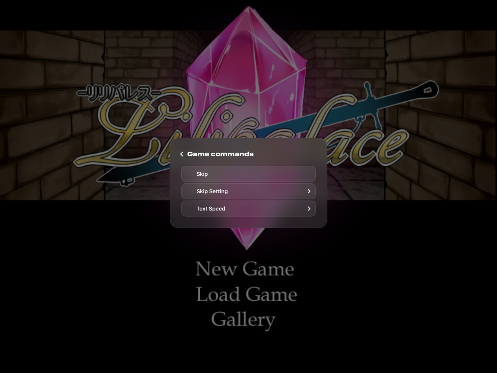

# Controls

Touch, mouse and keyboard, and game controllers all drive both the hub and the games. A controller alone reaches every screen, including Settings, the button mapping editor, adding a game, and the lock screen, and its text fields open an on-screen keyboard the controller types on.

  
  

## Control methods

Each game has its own control method (Automatic, Touch gamepad, Mouse, or Controller), switchable from the in-game menu. Mouse works by touch, where a tap clicks right where it lands, or by a cursor you drag like a trackpad. Controller shows no overlay and ignores touches unless its Mouse checkbox is on.

The touch gamepad has the D-pad, A, B, X, Y, LB, RB, LT, RT, View, and Menu. L3, R3, and the sticks come from a real controller.

## Buttons in games

In a game, the controller is an Xbox controller, except in engines with no gamepad support. Every button, from the touch gamepad or a real controller, reaches the game as the same Xbox button, and the game reads it with its own gamepad support. RPG Maker MV and MZ map a gamepad themselves, so A confirms, B cancels, X dashes, Y opens the menu, LB and RB turn pages, and the D-pad and left stick move. Like a real Xbox controller there, the Menu, View, and trigger buttons do nothing unless the game uses them.

KiriKiri, TyranoScript, Flash, and Artemis read no gamepad, so their games start with "Keyboard and mouse", the layout of Steam's Keyboard and Mouse controller template. LB turns the mouse wheel down and RB turns it up, LT right clicks, RT left clicks, View is Tab, and Menu is Escape. The left stick is W, A, S, and D, and pressing it in is Shift. The right stick moves the pointer, faster the further it is pushed, and pressing it in left clicks. The D-pad is 1, 2, 3, and 4, and A, B, X, and Y are Space, E, R, and F. The controller's Share button is not used. The touch gamepad gets the same buttons and has no sticks, so pointing on a touch device uses the Mouse control method.

"Mouse" is another layout the mapping editor offers. Both sticks move the pointer, A and RT left click, X and LT right click, LB turns the wheel down and RB turns it up, B and Menu press Escape, and Y shows the on-screen keyboard. The D-pad, View, and pressing the sticks in keep their Xbox buttons. On a Mac the controller moves the Mac's own pointer, and on iPhone and iPad a pointer arrow shows where it is. On iPhone and iPad the on-screen keyboard types into the game, with Return and Backspace, until the button or the keyboard's own key hides it. A Mac has its hardware keyboard, which already types into the game, so Show keyboard does nothing there.

With the Xbox gamepad layout instead, a TyranoScript game reads the gamepad when it turns that on in its Config.tjs (`useGamepad`), and each button its KeyConfig.js binds does what the game says. VNDegen turns every other button into the engine's own action: A reads on or presses the focused button, B cancels, X skips while held, Y and Menu open the game's menu, LB opens the backlog, RB turns auto mode on and off, and the D-pad and left stick move the focus. A Ren'Py game reads the controller itself in Ren'Py's own layout. On iPhone and iPad a Ren'Py game takes touches directly, with no touch controls over it, so its game page offers no control method.

While a game runs, the keyboard and mouse go straight to the game, which uses its own keys. For RPG Maker, MV and MZ as well as XP, VX, and VX Ace, those are the arrows, Z or Return, X or Escape, Shift, and Q and W. In a KiriKiri game on the Xbox gamepad layout, A is Return, B is a right click, Y and Menu are Escape, X holds Control, and L and R turn the mouse wheel, which opens and pages back through the message history, as in KAG3's own controls. A KiriKiri game's text fields get what the keyboard types, as on Windows. In an Artemis game, Return reads on, a right click opens the game's menu, Control skips, and the mouse wheel opens the message history.

## The library and the VNDegen menu

| Action in the library and the VNDegen menu | Controller | Keyboard in the library |
|---|---|---|
| Move | D-pad or left stick | Arrows or WASD |
| Confirm | A | Return or Space |
| Cancel | B | Escape or Backspace |
| Menu | Y or Menu | Tab |
| Open the focused game's menu | X | |
| Previous and next page | LB and RB | Q and E, or Page Up and Page Down |
| Open the VNDegen menu in a game (resume or quit to library) | Home, and View while the menu is open | Backtick (`` ` ``) |

A text field opens VNDegen's on-screen keyboard when you press A on it. A types the focused key, X deletes, LB toggles shift, RB switches to symbols, Y finishes, and B closes the keyboard without changes. In the button mapping editor, LB and RB jump between groups of buttons, and Reset returns the game to its engine's default layout. Remapping A or B never changes how the editor or the VNDegen menu respond. Adding a game by controller lists the archives in VNDegen's own folder (On My iPhone or On My iPad, VNDegen, on iOS). The Files and Photos pickers need touch or a mouse, and say so on screen.

A controller's Home button, the touch gamepad's house button, the small menu button in the corner, and the backtick always open the VNDegen menu, so a mapping cannot lock you out.

## Button mapping

Each game has its own button mapping. The VNDegen menu's Controls section and the game page's Controls section switch the control method and open the button mapping editor, which lists every Xbox button. Each button can send another Xbox button, a keyboard key, a left or right click, the scroll wheel up or down, mouse movement up, down, left, or right, Show keyboard, or nothing. A button or D-pad direction moves the pointer at a steady speed while held. Each stick also has a row that turns the whole stick into mouse movement, or back into a stick, in one step. Without a mapping, sticks are the controller's sticks.

At the top of the editor, "Keyboard and mouse" applies the layout KiriKiri, TyranoScript, Flash, and Artemis games start with, "Mouse" the pointer layout above, and "RPG Maker controls" maps the buttons to the keys RPG Maker reads: A to Return, B to Escape, X to Shift, Y and Menu to X, LB to Q, RB to W, and the D-pad and left stick to the arrows. Return confirms in every RPG Maker, where XP uses Z for another button, and Escape and X both cancel and open the menu. "Xbox gamepad" clears every remap, so every button sends its own Xbox button. Ren'Py applies the mapping too, except mouse movement, the wheel, and Show keyboard, since Ren'Py reads the controller itself. A remapped touch button shows what it sends, for example "Esc".

Remaps saved by earlier versions, which sent actions such as Confirm, convert on first launch to what those actions sent in the game's engine, so remapped games play the same: the Return key in RPG Maker, the matching Xbox button in Ren'Py, and the same TyranoScript action in TyranoScript.

## Game commands

Commands a game keeps where VNDegen draws nothing, such as a KiriKiri game's window menu bar, appear under Game commands in the VNDegen menu, with the game's own captions, submenus, check marks, and disabled items. Choosing one closes the VNDegen menu and the game runs it, as on the PC. Items VNDegen's own menu covers, such as Exit and Full Screen, are left out, and games without such commands don't show the entry.

  

Game commands list one level of the game's menu at a time. Up and down move, A opens a submenu or runs a command, B goes back a level, and from the top back to the VNDegen menu. Touch and a mouse choose an item directly, and the arrow at the top goes back. A KiriKiri game whose scripts check whether the window's menu bar is hidden, and then put their commands on screen, is told it is hidden, so those buttons show. Any other KiriKiri game is told it shows, so the game builds its menu for Game commands. The game page's Window menu option overrides that per game.

On iPhone and iPad, VNDegen's Ren'Py menu offers Quick save and Quick load when the game's quick menu for this device has no QuickSave action. They use the game's own quick save slot. If VNDegen cannot inspect the quick menu, it offers both commands when the game supports quick saves.

## Cheats

RPG Maker MV, MZ, XP, VX, and VX Ace games have a Cheats page in the VNDegen menu: add gold, items, weapons, and armor by name from the game's own database, restore the party's HP and MP, keep them full, turn random encounters off, walk through walls, multiply experience, and run the game at 2x or 4x speed. A Variables and a Switches tab list the game's numbered variables and switches with the names its database gives them, and edit them in place. Every change goes through the game's own objects, so a save made afterwards is an ordinary save that loads on the PC. Cheats are off until you turn one on. The settings that stay on, such as game speed, are kept per game and shown on its game page.

The Cheats page has tabs for quick cheats, items, variables, and switches, which LB and RB switch between. Up and down move, A runs a cheat or turns a setting on and off, and left and right step game speed and the experience rate, and add or take 1 from the focused variable. A on a variable opens the on-screen keyboard on its value, and Y sets it. The search field matches names, or a number with or without `#`. Gold, items, the party, variables, and switches wait until a game is started or loaded, since starting or loading one replaces them. To undo a change, load a save made before it.

[cheats.md](cheats.md) has the design and the plans for other engines.
